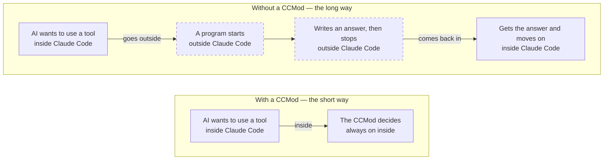
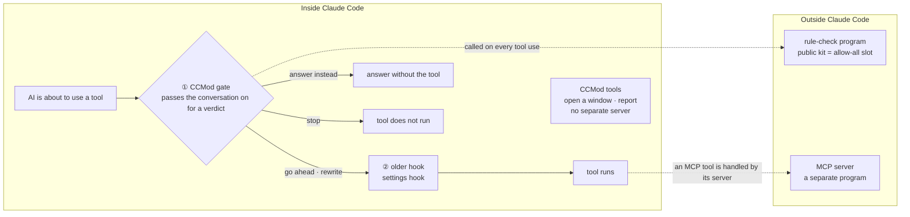

# mod-for-slack (preview)

[한국어](README.md)

> This is a «preview (alpha)» release — please report problems as issues.
> This project used to be called SlackMod. If you already installed it, keep using it as is — the `slackmod` command and the `~/.slackmod` folder have not changed ([details](docs/developers.en.md#about-the-name)).

Write something in Slack and the Claude Code bot on your computer picks it up and does the work. Short tasks get an answer right there. Longer work that takes several steps is handed to a new window that looks after that thread only (a sub-session). Each thread gets its own window, so different jobs do not get mixed up. Bots can also talk in a channel where people you allowed (guests) are present; for guests it only talks and answers; it does not change files or run commands.

## In plain words — why mod-for-slack

An AI worker (Claude Code) normally works inside one text window (a terminal) on one computer. Used as is, that brings a few everyday problems.

| Everyday problem | With mod-for-slack |
|---|---|
| You have to sit at that computer to give it work | Write in Slack and the bot picks it up. Anywhere Slack works, including your phone |
| Give one window several jobs and the conversations get mixed up — talk from the last job slips into the next, and the longer the window gets, the more the AI gets confused | Each job (each thread) gets its own sub-session (a new window). When the sub-session is done, it reports only the result back to the bot, once |
| Bring an AI into a room with several people and it is hard to say whose words it should follow | You set an owner and guests during install. Guests only get conversation and replies, and the tools that change files or run commands refuse by themselves (how it works and its limits: [developer guide](docs/developers.en.md#owner-and-guests)) |
| You cannot see at a glance what is happening and how far it has come | (Optional) the web board shows what each bot is doing and, for each job, a «start → steps → goal» picture in this computer's browser ([«Turn on the web board» in the install guide](docs/install.en.md#turn-on-the-web-board-optional)) |
| Moving the skills and settings you already use to a new bot is a chore | The setup wizard only reads what you already have, shows it, and asks whether to bring in copies |

Think of a restaurant kitchen. Each order slip (a thread) gets one cook (a sub-session), and the head chef (the bot) only hears «it's ready». So the head chef never has to keep every order's backstory in mind. The work flows like this — **you write → the bot picks it up → a sub-session of its own takes it → it reports to the bot → the answer goes in the thread**.

**When you do not need mod-for-slack:** when you work alone in one terminal window, watching the screen, on short jobs — going through Slack would just add a step.

There are two layers.

- **CCMOD (Claude Code mod)** — the framework for add-ons that change how Claude Code looks and behaves. A mod runs with your account's permissions, so only add mods you trust ([official docs](https://code.claude.com/docs/en/plugins/mods/overview.md)).
- **mod-for-slack** — this repository's kit, built on that framework. It connects Slack to your bots, hands longer work to sub-sessions, and shows a status board beside the bot's screen.

## CCMod is not just a nicer screen — how it makes hooks and tools work better

Claude Code already has "hooks": checkpoints that step in right before the AI edits a file or runs a command. The older kind (settings hooks) runs a short program outside Claude Code each time something happens and gets an answer back.

A CCMod hook runs as a function "inside" Claude Code ([official docs](https://code.claude.com/docs/en/plugins/mods/overview.md)). That lets it do more.



A CCMod is a part that stays switched on inside Claude Code. The two rows draw the same job, the check right before the AI uses a tool, both ways; the bottom row is the basic CCMod shape. On top of that, mod-for-slack calls a rule-check program outside once each time a tool is used. The CCMod inside makes that call before the hooks you set in your own settings, and hands the program the conversation so far. Row length shows the places passed and does not mean faster.

| Older way (settings hook) | CCMod hook |
|---|---|
| Runs a program outside Claude Code each time | Called right inside Claude Code |
| Decides whether to go ahead and what to pass on | Watch and rewrite, and also answer in place of the tool without running it |
| Gets what it is handed, and has to read the transcript file separately to see the conversation | Pulls up the conversation so far right inside the function |
| Each hook call runs a separate program, so sharing memory means writing files | Hooks share the same memory and can show it on screen |

Giving the AI tools works differently too. MCP is a standard way to connect outside programs' tools to the AI. It is like a shop outside: the tools live in a separate program (a server), and Claude Code connects to it. A CCMod registers its tools right inside Claude Code. There is no separate server, and the tools are ready before the first question when a new conversation (session) starts.

**A closer look — the path of one tool call**



mod-for-slack uses both like this:

- Right before any tool is used, a CCMod function looks first. On a turn where a message from a guest (anyone but the owner) came in, it refuses on the spot everything except reading and Slack replies. Editing files and running commands are blocked.
- Slack replies going to a thread in the owner's DM get the owner's tag added. This shows that a CCMod can also catch and rewrite calls to outside (MCP) tools.
- The CCMod registers the tools for opening a sub-session and reporting back: open a new window, report, post to the board, and so on. A sub-session is a new Claude Code window that takes on part of the work.
- There is also a gate that calls hook checks of the older kind (a rule-check program) from this spot. The public kit ships only an "allow everything" check there. You can plug in your own.

Good to know

- Neither the official docs nor our own measurements give an "N times faster" figure. What changes is "where it stands and what it can see". Our gate still calls a separate checking program when it checks.
- If other programs need the same tool, MCP is the right fit. CCMod tools exist only inside Claude Code.
- A CCMod can do anything your account can do, and it runs outside the sandbox that keeps commands contained. Add only ones you trust.

Where this lives in the code, with the official sources, is in the [developer guide, "How a CCMod makes hooks and MCP-style tools work better"](docs/developers.en.md#how-a-ccmod-makes-hooks-and-mcp-style-tools-work-better).

## Who this guide is for

- **First-time users** — follow this page from the top: install → first use → undo. Unfamiliar words are collected at the bottom in [«Words used here»](#words-used-here). For the install step by step, see the [install guide](docs/install.en.md).
- **Developers** — folder layout · config files · how it works inside · how to change and extend it · running the tests are in the [developer guide](docs/developers.en.md).

## Install

### Install Claude Code first

This setup helper assumes **a computer that already has Claude Code**. If you do not have it yet, install it first.

- **Windows** — an all-in-one installer: https://github.com/treylom/cc-codex-easyinstall (installs Linux inside Windows (WSL · Ubuntu), Claude Code and tmux together). The bots run inside that Ubuntu window — when the install is done, open «Ubuntu» from the Start menu and type the commands below in that window.
- **macOS · Linux · WSL** — the official one-liner (no admin rights): `curl -fsSL https://claude.ai/install.sh | bash` → open `claude` once in a new window and sign in.

### Download and install (macOS · WSL Ubuntu · Linux)

```bash
git clone <this repository's URL> mod-for-slack && cd mod-for-slack
bash install.sh
```

`install.sh` checks the programs it needs, then the **setup wizard** starts inside Claude Code. Answer the wizard's questions and it installs everything in one go. At the end you enter the Slack tokens in a terminal window it opens.

No Slack app yet? See [Create the Slack app and get its tokens](docs/slack-app.en.md). It is one app per bot.

What the wizard asks, how to start the bots again, the web board, and what to do when something goes wrong are in the [install guide](docs/install.en.md).

## First use

1. Start the bots: `slackmod start all` in the terminal (skip this if the setup wizard already started them at the end). Check with `slackmod status` — each bot should show «켜짐» (on). A bot started for the first time shows confirmation screens in its window and waits. Go in with `slackmod attach <bot>`, arrow down to "Yes" and press Enter (plain Enter turns the bot off). Details: [«First check» in the install guide](docs/install.en.md#first-check).
2. Talk to a bot in Slack: send it a DM, or invite it to the channel you entered during setup (`/invite @botname`) and call it with `@botname`.
3. Short tasks get an answer right there. For work that takes several steps, the bot leaves a one-line «a sub-session has taken this» note. Then it opens a new window (a sub-session) that looks after that thread only. When the sub-session finishes, the bot posts the result in the same thread.
4. To see what a bot is doing, run `slackmod attach <bot>` in the terminal — the bot's screen opens (in tmux, to leave: press Ctrl+b, release, then d). The status board beside it shows whether the bot and its sub-sessions are working, idle or waiting.
5. Not sure what to ask for? Ask the bot «what should I use?» — it picks only from the features this bot really has.

After you restart the computer, the bots do not start by themselves. Run `slackmod start all` once in the terminal.

If you turn on the web board (optional), you can see the bots and how far each project has come in this computer's browser. How to turn it on is in [«Turn on the web board» in the install guide](docs/install.en.md#turn-on-the-web-board-optional).

### Public repositories that go well with it

These are our public repositories that the wizard's "recommended skills" section suggests when they fit (only what you pick goes in). To add one yourself, type the two lines inside Claude Code.

- Notes-folder organizing helper — https://github.com/treylom/knowledge-manager · `/plugin marketplace add treylom/knowledge-manager` → `/plugin install km@knowledge-manager`
- Polishing request prompts — https://github.com/treylom/prompt-engineering-skills · `/plugin marketplace add treylom/prompt-engineering-skills` → `/plugin install prompt-engineering-skills@prompt-engineering-skills`

## Undo

To undo **only the install you just did**, run `slackmod undo` in the terminal — it first shows what will be rolled back. If that looks right, `slackmod undo --yes`. If even one file was edited by hand after the install, it touches nothing, shows the list of those files and stops. Slack tokens (the bot's `slack/.env`) are not rolled back. Undoing the very first install removes mod-for-slack itself, as it was before the install.

To remove mod-for-slack completely, follow these steps.

1. Stop all bots with `slackmod stop all`.
2. If there are files you want back, copy them out of `~/.slackmod/backup/<time>/` first. The pre-install copy of your shell settings file is there too. This folder is inside `~/.slackmod`, so the last step deletes it as well.
3. Delete the `# >>> slackmod >>>` block from your shell settings file (`~/.zshrc` or `~/.bashrc`).
4. Delete the `~/.slackmod` folder. The token files, your project rooms (`~/.slackmod/rooms`) and the web board settings (`~/.slackmod/web-board`) go with it, so move the rooms out first if you want to keep them.

Bot work folders (default `~/bots/<name>`) and the files the wizard put in them (character file · `.claude/settings.json` · `.mcp.json`) stay, so delete them yourself if you no longer need them.

## Words used here

- **Bot** — one Claude Code window connected to one Slack app. You set its name and personality in the wizard.
- **Sub-session** — a new Claude Code window the bot opens to hand over the work of one thread. It works on that thread only and reports back to the bot when it is done.
- **Status board** — the pane beside the bot's screen. It shows what the bot and its sub-sessions are doing right now.
- **Web board** — an optional page in this computer's browser that shows the bots and the progress of project rooms.
- **Slack bridge** — a small program that passes messages between Slack and the bot's window. Each bot has its own.
- **Tokens** — two password-like values the Slack app gives the bot (`xoxb-` · `xapp-`). Keep them private.
- **Setup wizard** — the helper that starts when you run `bash install.sh`: it asks, lets you choose and installs, inside Claude Code.
- **Multi-window tool** — a program that keeps several windows in one terminal (tmux etc.). Bots and sub-sessions run there.
- **Owner · guest** — owner = the person who installs the bots and gives them work. Guest = someone the owner allows to talk with the bot in the same channel (conversation and replies only).
- **Mod (CCMOD)** — an add-on that changes how Claude Code looks and behaves.
- **Skill** — a packaged procedure (one file) the bot pulls out for a particular job. You pick them in the wizard's «recommended skills» section.

## License

MIT — [LICENSE](LICENSE). Some bot-personality templates generalize MIT-licensed public templates ([setup/ATTRIBUTIONS.md](setup/ATTRIBUTIONS.md)).

## 한국어

한국어 README 는 [README.md](README.md) 입니다.
