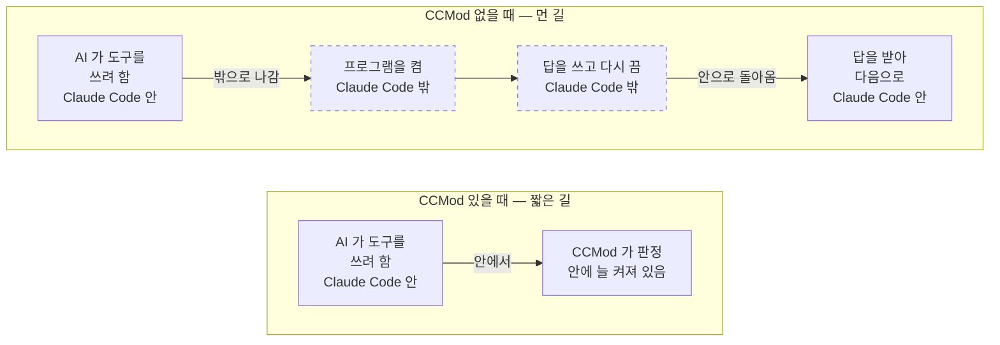
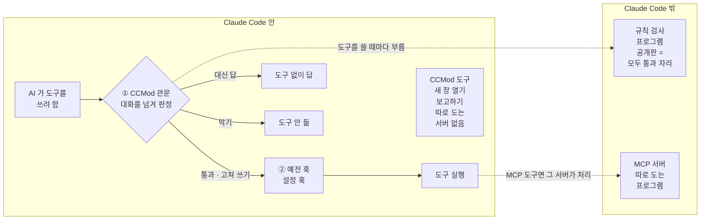

# mod-for-slack (미리보기)

[English](README.en.md)

> 지금은 «미리보기(알파)» 판입니다 — 문제는 이슈로 알려 주세요.
> 예전 이름은 SlackMod 입니다. 이미 설치했다면 그대로 쓰면 됩니다 — 명령 `slackmod` 와 설치 폴더 `~/.slackmod` 는 바뀌지 않았습니다([자세히](docs/developers.md#이름에-대해)).

Slack 에 글을 쓰면 내 컴퓨터의 Claude Code 봇이 받아서 일합니다. 짧은 일은 그 자리에서 답합니다. 여러 단계가 걸리는 긴 일은 그 스레드만 맡는 새 창(하위 세션)을 열어 따로 맡깁니다. 스레드마다 창이 따로라서 일이 서로 섞이지 않습니다. 허락한 사람(손님)이 있는 채널에서도 대화할 수 있고, 손님 글에는 말로 답하기만 하고, 파일을 고치거나 명령을 돌리지는 않습니다.

## 쉽게 말하면 — 왜 mod-for-slack 인가

AI 일꾼(Claude Code)은 원래 컴퓨터의 글자 창(터미널) 하나 안에서 일합니다. 그대로 쓰면 이런 불편이 생깁니다.

| 흔한 불편 | mod-for-slack 에서는 |
|---|---|
| 그 컴퓨터 앞에 앉아 있어야 일을 시킬 수 있다 | Slack 에 글을 쓰면 봇이 받습니다. Slack 이 되는 곳이면 휴대폰에서도 됩니다 |
| 한 창에 일을 여러 개 시키면 이야기가 섞인다 — 앞 일의 대화가 다음 일에 끼어들고, 창이 길어질수록 AI 가 헷갈린다 | 일 하나(스레드 하나)마다 전용 하위 세션(새 창)을 따로 엽니다. 하위 세션은 일을 마치면 봇에게 결과만 한 번 보고합니다 |
| 여러 사람이 있는 방에 AI 를 들이면 누구 말을 따를지 정하기 어렵다 | 설치할 때 주인과 손님을 정합니다. 손님 글에는 대화와 답만 하고, 파일을 고치거나 명령을 돌리는 도구는 스스로 거절합니다(자세한 동작과 한계는 [개발자 안내](docs/developers.md#주인과-손님)) |
| 지금 무슨 일이 어디까지 됐는지 한눈에 안 보인다 | (선택) 웹 현황판이 봇마다 하는 일과, 일마다 «시작 → 단계 → 목표» 그림을 이 컴퓨터 브라우저에 보여 줍니다([설치 안내의 «현황판 켜기»](docs/install.md#현황판-켜기-선택)) |
| 쓰던 스킬·설정을 새 봇에 옮기기 번거롭다 | 설치 마법사가 이미 있는 것을 읽기만 해서 보여 주고, 사본으로 가져올지 묻습니다 |

비유하면 식당 주방입니다. 주문서(스레드) 한 장마다 요리사(하위 세션) 한 명이 붙고, 주방장(봇)은 «다 됐어요» 보고만 받습니다. 그래서 주방장 머릿속에 모든 주문의 사연이 쌓이지 않습니다. 일은 이렇게 흐릅니다 — **글을 씀 → 봇이 받음 → 전용 하위 세션이 맡음 → 봇에게 보고 → 스레드에 답**.

**이럴 땐 mod-for-slack 없이도 됩니다:** 터미널 한 창에서 혼자, 화면을 보며 짧은 일을 할 때 — Slack 을 거치면 한 단계만 늘어납니다.

두 층으로 보면 이렇습니다.

- **CCMOD(Claude Code mod)** — Claude Code 에 붙여 화면과 동작을 바꾸는 추가 기능의 틀입니다. 내 계정 권한으로 도는 프로그램이라 믿을 수 있는 것만 붙여야 합니다([공식 안내](https://code.claude.com/docs/en/plugins/mods/overview.md)).
- **mod-for-slack** — 그 틀 위에 만든 이 저장소의 묶음입니다. Slack 과 봇을 잇고, 긴 일을 하위 세션에 맡기고, 봇 화면 옆에 현황판을 띄웁니다.

## CCMod 는 화면만 바꾸는 게 아닙니다 — 훅과 도구가 더 잘 도는 원리

Claude Code 에는 원래 «훅»이 있습니다. AI 가 파일을 고치거나 명령을 돌리기 직전에 끼어드는 검문소입니다. 예전 방식(설정 훅)은 일이 생길 때마다 Claude Code 밖에서 짧은 프로그램을 따로 돌려 답을 받아 옵니다.

CCMod 의 훅은 Claude Code «안»에서 함수로 돌아갑니다([공식 안내](https://code.claude.com/docs/en/plugins/mods/overview.md)). 그래서 할 수 있는 일이 늘어납니다.



CCMod 는 Claude Code 안에 늘 켜져 있는 부품입니다. 위아래 두 줄은 AI 가 도구를 쓰기 직전의 검사라는 같은 일을 두 방식으로 그린 것이고, 아래 줄이 CCMod 의 기본 꼴입니다. mod-for-slack 은 여기에 더해 도구를 쓸 때마다 규칙 검사 프로그램을 밖에서 한 번 부릅니다. 이 부름은 안에 켜진 CCMod 가 내가 설정해 둔 훅보다 먼저 하고, 그때 지금까지의 대화도 검사 프로그램에 함께 넘깁니다. 줄 길이는 거쳐 가는 자리를 보여 줄 뿐이고, 더 빠르다는 뜻이 아닙니다.

| 예전 방식(설정 훅) | CCMod 훅 |
|---|---|
| 일이 생길 때마다 밖에서 프로그램을 돌림 | Claude Code 안에서 바로 불림 |
| 진행 여부와 넘길 내용을 정해 돌려줌 | 지켜보기 · 고쳐 쓰기에 더해, 도구를 돌리지 않고 대신 답하기까지 |
| 넘겨받은 내용 말고 대화를 보려면 대화 기록 파일을 따로 읽어야 함 | 지금까지의 대화를 함수 안에서 바로 꺼내 봄 |
| 부를 때마다 따로 도는 프로그램이라 기억을 나누려면 파일에 적어 둬야 함 | 훅끼리 같은 기억을 나누고 화면에도 보여 줌 |

AI 에게 도구를 주는 길도 다릅니다. MCP 는 바깥 프로그램의 도구를 AI 에 이어 주는 방식으로, 바깥 가게와 비슷합니다. 도구는 따로 도는 프로그램(서버)에 있고, Claude Code 가 그 서버에 연결해 씁니다. CCMod 는 도구를 Claude Code 안에서 바로 등록합니다. 따로 도는 서버가 없고 새 대화(세션)를 시작하면 첫 질문 전에 실립니다.

**한 번 더 자세히 — 도구를 한 번 쓸 때 지나는 길**



mod-for-slack 은 이 두 가지를 이렇게 씁니다.

- 도구를 쓰기 직전마다 CCMod 함수가 먼저 봅니다. 손님(주인이 아닌 사람) 글이 들어온 차례면 읽기와 Slack 답 말고는 그 자리에서 거절합니다(파일 고치기 · 명령 실행이 막힘).
- 주인 DM 스레드로 나가는 Slack 답에는 주인 태그를 붙여 고쳐 씁니다. 바깥 도구(MCP) 호출도 CCMod 가 받아 고칠 수 있다는 예입니다.
- CCMod 는 하위 세션을 열고 결과를 보고받는 도구를 Claude Code 안에서 등록합니다. 새 창 열기 · 보고하기 · 게시판 쓰기 같은 도구입니다. 하위 세션은 일을 나눠 맡는 새 Claude Code 창입니다.
- 예전 방식의 훅 검사(규칙 검사 프로그램)를 이 자리에서 부르는 관문도 있습니다. 공개판의 그 자리에는 «모두 통과» 검사만 들어 있습니다. 여기에 내 검사를 끼워 넣으면 됩니다.

알아 둘 점

- «몇 배 빨라진다»는 숫자는 공식 문서에도, 우리 측정에도 없습니다. 달라지는 것은 «어디에 서서 무엇을 볼 수 있느냐»입니다. 우리 관문도 검사할 때는 검사 프로그램을 따로 부릅니다.
- 다른 프로그램도 같이 쓰는 도구라면 MCP 가 맞습니다. CCMod 도구는 Claude Code 안에서만 쓰입니다.
- CCMod 는 내 계정이 할 수 있는 일을 모두 할 수 있고, 따로 가둬 두는 장치(샌드박스) 밖에서 돌아갑니다. 믿을 수 있는 것만 붙이세요.

코드 자리와 공식 문서 근거는 [개발자 안내 «CCMod 가 훅과 MCP 같은 도구를 더 잘 돌게 하는 원리»](docs/developers.md#ccmod-가-훅과-mcp-같은-도구를-더-잘-돌게-하는-원리)에 있습니다.

## 누구를 위한 안내인가요

- **처음 쓰는 분** — 이 문서를 위에서부터 따라 하면 됩니다: 설치 → 처음 쓰기 → 되돌리기. 낯선 말은 맨 아래 [«말 풀이»](#말-풀이)에 모았습니다. 설치를 한 단계씩 자세히 보려면 [설치 안내](docs/install.md)를 보세요.
- **개발자** — 폴더 구조 · 설정 파일 · 안쪽 동작 · 고쳐 쓰고 늘리는 법 · 시험 돌리기는 [개발자 안내](docs/developers.md)에 따로 모았습니다.

## 설치

### Claude Code 먼저 깔기

이 설치 도우미는 **Claude Code 가 이미 깔린 컴퓨터**를 전제로 합니다. 아직 없다면 먼저 깔고 오세요.

- **윈도우** — 한 번에 깔아 주는 설치기: https://github.com/treylom/cc-codex-easyinstall (윈도우 안 리눅스(WSL·Ubuntu) · Claude Code · tmux 를 함께 깝니다). 봇은 그 Ubuntu 창 안에서 돌아갑니다 — 설치가 끝나면 시작 메뉴의 «Ubuntu» 를 열고 아래 명령을 그 창에서 치세요.
- **맥 · 리눅스 · WSL** — 공식 한 줄(관리자 권한 없이): `curl -fsSL https://claude.ai/install.sh | bash` → 새 창에서 `claude` 를 한 번 열어 로그인.

### 내려받고 설치하기 (macOS · WSL Ubuntu · Linux)

```bash
git clone <이 저장소 주소> mod-for-slack && cd mod-for-slack
bash install.sh
```

`install.sh` 가 필요한 프로그램을 점검한 뒤, Claude Code 안에서 **설치 마법사**가 시작됩니다. 마법사가 묻는 대로 고르면 한 번에 설치됩니다. 마지막에 열리는 터미널 창에서 Slack 열쇠를 넣습니다.

Slack 앱이 아직 없으면 [Slack 앱 만들고 열쇠 받기](docs/slack-app.md)를 보세요. 봇 하나에 앱 하나입니다.

마법사가 무엇을 묻는지, 다시 켜는 법, 웹 현황판, 안 될 때는 [설치 안내](docs/install.md)에 자세히 있습니다.

## 처음 쓰기

1. 봇을 켭니다: 터미널에서 `slackmod start all`(설치 마법사가 끝에 이미 켰다면 건너뛰세요). 확인은 `slackmod status` — 봇마다 «켜짐»이 보이면 됩니다. 처음 켠 봇은 봇 창에 확인 화면을 띄우고 기다립니다. `slackmod attach <봇>` 으로 들어가 아래 화살표로 «Yes» 를 고른 뒤 Enter 를 누르세요(그냥 Enter 를 누르면 봇이 꺼집니다). 자세히는 [설치 안내의 «첫 확인»](docs/install.md#첫-확인).
2. Slack 에서 말을 겁니다: 봇에게 바로 DM 을 보내거나, 설치 때 적은 채널에 봇을 초대(`/invite @봇이름`)한 뒤 `@봇이름` 으로 부릅니다.
3. 짧은 일은 봇이 그 자리에서 답합니다. 여러 단계가 걸리는 일은 봇이 «하위 세션이 맡았어요» 한 줄을 남깁니다. 그리고 그 스레드만 맡는 새 창(하위 세션)을 엽니다. 하위 세션이 끝나면 봇이 결과를 같은 스레드에 올립니다.
4. 봇이 무엇을 하는지 보려면 터미널에서 `slackmod attach <봇>` — 봇 화면이 열립니다(tmux 라면 나오기 = Ctrl+b 를 눌렀다 뗀 뒤 d). 화면 옆 현황판에 봇과 하위 세션이 지금 일하는지·쉬는지·기다리는지가 보입니다.
5. 무엇을 시킬 수 있는지 모르겠으면 봇에게 «무엇을 쓰면 되나요?»라고 물어보세요 — 이 봇에 실제로 들어 있는 기능만 골라 알려 줍니다.

컴퓨터를 다시 켠 뒤에는 봇이 저절로 켜지지 않습니다. 터미널에서 `slackmod start all` 을 한 번 치세요.

웹 현황판(선택)을 켜면 봇들과 프로젝트마다 일이 어디까지 왔는지를 이 컴퓨터 브라우저에서 볼 수 있습니다. 켜는 법은 [설치 안내의 «현황판 켜기»](docs/install.md#현황판-켜기-선택)를 보세요.

### 함께 쓰면 좋은 공개 저장소

설치 마법사의 «추천 스킬» 칸이 조건에 맞을 때 권하는 우리 공개 저장소입니다(고른 것만 넣습니다). 따로 넣으려면 Claude Code 안에서 두 줄씩 칩니다.

- 노트 폴더 정리 도우미 — https://github.com/treylom/knowledge-manager · `/plugin marketplace add treylom/knowledge-manager` → `/plugin install km@knowledge-manager`
- 부탁 글 다듬기 — https://github.com/treylom/prompt-engineering-skills · `/plugin marketplace add treylom/prompt-engineering-skills` → `/plugin install prompt-engineering-skills@prompt-engineering-skills`

## 되돌리기

**방금 한 설치 하나만** 되돌리려면 터미널에서 `slackmod undo` — 무엇이 돌아가는지 먼저 보여 줍니다. 괜찮으면 `slackmod undo --yes`. 설치 뒤에 손으로 고친 파일이 하나라도 있으면 아무것도 건드리지 않고 그 파일 목록만 보여 주고 멈춥니다. Slack 열쇠(봇의 `slack/.env`)는 되돌리지 않습니다. 처음 설치를 되돌리면 mod-for-slack 자체가 설치 전처럼 지워집니다.

mod-for-slack 을 통째로 지우려면 아래 순서대로 합니다.

1. `slackmod stop all` 로 봇을 모두 끕니다.
2. 되살릴 파일이 있으면 `~/.slackmod/backup/<시각>/` 에서 먼저 꺼내 둡니다. 설치 전 셸 설정 파일 사본도 여기 있습니다. 이 폴더도 `~/.slackmod` 안이라 마지막 단계에서 같이 지워집니다.
3. 셸 설정 파일(`~/.zshrc` 또는 `~/.bashrc`)에서 `# >>> slackmod >>>` 칸을 지웁니다.
4. `~/.slackmod` 폴더를 지웁니다. 열쇠 파일과 프로젝트 방 기록(`~/.slackmod/rooms`) · 현황판 설정(`~/.slackmod/web-board`)도 같이 지워지니, 방 기록을 남기려면 먼저 옮겨 두세요.

봇 작업 폴더(기본 `~/bots/<이름>`)와 마법사가 그 안에 넣은 파일(성격 파일 · `.claude/settings.json` · `.mcp.json`)은 남으니, 필요 없으면 따로 지우세요.

## 말 풀이

- **봇** — Slack 앱 하나와 이어진 Claude Code 창 하나. 이름과 성격을 마법사에서 정합니다.
- **하위 세션** — 봇이 스레드 하나의 일을 맡기려고 새로 여는 Claude Code 창. 그 스레드 일만 하고, 끝나면 봇에게 결과를 알립니다.
- **현황판** — 봇 화면 옆 칸. 봇과 하위 세션이 지금 무엇을 하는지 보여 줍니다.
- **웹 현황판** — 봇들과 프로젝트 방의 진행을 이 컴퓨터 브라우저에서 보는 웹 페이지(선택).
- **Slack 다리** — Slack 과 봇 창 사이에서 글을 주고받는 작은 프로그램. 봇마다 하나씩 따로 돌아갑니다.
- **열쇠(토큰)** — Slack 앱이 봇에게 주는 비밀번호 같은 값 두 개(`xoxb-` · `xapp-`). 남에게 보이면 안 됩니다.
- **설치 마법사** — `bash install.sh` 를 치면 Claude Code 안에서 묻고 고르게 하며 설치를 이끄는 도우미.
- **다중 창 도구** — 창 여러 개를 한 터미널에서 띄워 두는 프로그램(tmux 등). 봇과 하위 세션이 여기서 돌아갑니다.
- **주인 · 손님** — 주인 = 봇을 설치하고 일을 시키는 사람. 손님 = 주인이 허락해 같은 채널에서 봇과 대화할 수 있는 사람(대화와 답만).
- **mod(CCMOD)** — Claude Code 에 붙여 화면과 동작을 바꾸는 추가 기능.
- **스킬** — 봇이 특정 일을 할 때 꺼내 쓰는 절차 묶음(파일 하나). 마법사의 «추천 스킬» 칸에서 고릅니다.

## 라이선스

MIT — [LICENSE](LICENSE). 봇 성격 틀 일부는 MIT 공개 틀을 일반화했습니다([setup/ATTRIBUTIONS.md](setup/ATTRIBUTIONS.md)).

## English

The English README is [README.en.md](README.en.md).
