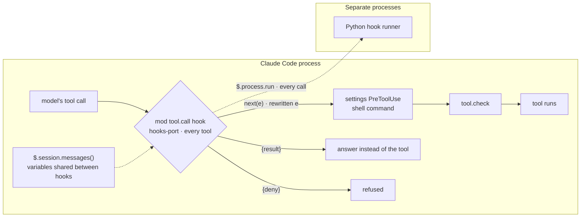
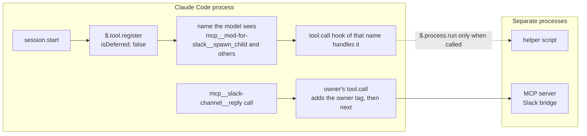

# Developer guide

[한국어](developers.md) · [For first-time users (README)](../README.en.md) · [Install guide](install.en.md)

This page is for developers who want to change or extend mod-for-slack. For installing and first use, see the [README](../README.en.md) and the [install guide](install.en.md).

## Two layers

- **Claude Code mod** — a plugin that changes how Claude Code looks and behaves. A plugin becomes a mod when its `hooks/hooks.json` has a `modules` key pointing to a module (`register.js`) that exports `register(on)`. Handlers attach to events (`tool.call` · `prompt.submit` · `turn.complete` · `ui.render` · `session.*` and others) and use the `$` they receive (the mods API) for panes, bands, the status line and notifications (`$.ui`), commands (`$.command`), tools (`$.tool`) and more. Needs terminal Claude Code 2.1.287 or later. Official docs: [overview](https://code.claude.com/docs/en/plugins/mods/overview.md) · [API](https://code.claude.com/docs/en/plugins/mods/api.md) · [reference](https://code.claude.com/docs/en/plugins/mods/reference.md).
- **mod-for-slack** — one plugin built on that framework (`slackmod/app/mods-harness`), plus the kit that connects it to Slack and handles install and start-up.

The full mods API types are not in this repository. When Claude Code loads a plugin with `--plugin-dir`, it writes them into that plugin's `.claude-plugin/types/claude-code/index.d.ts`. The repository's `types/index.d.ts` is a small file that only lists the state keys this plugin uses (`mh.*`).

## How a CCMod makes hooks and MCP-style tools work better

Start from the official definitions ([overview, "Compare mods, settings hooks, skills, and MCP servers"](https://code.claude.com/docs/en/plugins/mods/overview.md)).

| | Definition (official docs) |
|---|---|
| Settings hook | A shell command, HTTP request, or prompt that Claude Code runs on a lifecycle event |
| MCP server | An external process or service that gives Claude tools |
| Mod | Functions in a plugin that Claude Code calls in its own process |

### Hooks

- **Range of outcomes** — a settings hook can change whether a call goes ahead, its arguments and result, and added context. A mod hook observes with `next(e)`, passes a rewritten `e`, refuses with `{deny}`, or answers with `{result}` without running the tool (Observe · Rewrite · Answer · [overview](https://code.claude.com/docs/en/plugins/mods/overview.md)).
- **What it can see** — inside the hook, `$.session.messages()` returns the transcript (latest 4,096 entries) ([API](https://code.claude.com/docs/en/plugins/mods/api.md) · the limit is in [reference, "Limits"](https://code.claude.com/docs/en/plugins/mods/reference.md)). Hooks in one module share variables, so what one hook counts, another can show on screen.
- **Order** — a mod's `tool.call` runs before settings `PreToolUse`. The one exception: `PreToolUse` hooks from managed settings run before the mods. If a mod answers without calling `next`, the settings hooks after it do not run. `tool.check` comes after both ([events, "Where settings hooks run in the order"](https://code.claude.com/docs/en/plugins/mods/events.md) · [reference](https://code.claude.com/docs/en/plugins/mods/reference.md)).
- **Failure** — a hook that throws an exception is skipped. Hook run time is capped at 10 s; time spent waiting on `next` and API calls is not counted ([reference](https://code.claude.com/docs/en/plugins/mods/reference.md)).



### Tools

- `$.tool.register` registers a tool in `session.start`, and it finishes before the first prompt. Claude sees it under the same name shape as MCP, `mcp__<plugin>__<name>`, and a `tool.call` hook of that name handles the call. There is no resident server and no connect step. With `isDeferred: false` it is loaded from the start instead of being deferred by tool search ([API, "Add a tool"](https://code.claude.com/docs/en/plugins/mods/api.md)).
- Calls to external MCP tools can also be caught in `tool.call` and rewritten.



### In the mod-for-slack code

Paths below are relative to the plugin folder `slackmod/app/mods-harness/`. The tool-name prefix is the name in plugin.json (`mod-for-slack`), not the folder name.

- **Guest-turn refusal** — the `tool.call` in `src/session/index.js` refuses with `{deny}`, on the spot, any tool outside the allow list during a main turn where a guest's message came in. The allow list is `Read` · `Glob` · `Grep` · `ToolSearch` · Slack reply · reaction. A sub-session's Slack tools may write only to its own thread.
- **Gate (the old hook-check slot)** — the `tool.call` in `src/hooks-port/index.js` matches every tool with the regex `/^/` and stands before settings `PreToolUse`. On every call it runs the Python hook runner through `$.process.run`, also passing it `$.session.messages()` when a policy asks for them, and merges the runner's result into `{deny}` or added context. The only check the public kit puts in that slot is `slackmod/hooks/pass.sh`, which allows everything.
- **Rewriting an external MCP call** — `src/owner/index.js` takes the `tool.call` of `mcp__slack-channel__reply`, adds the owner's tag to replies in the owner's DM threads, and passes it on with `next({...e, text})`. The setting is `owner_tag`, on by default.
- **Tools** — `spawn_child` · `list_children` · `close_child` · `send_to_child` · `report_to_parent` · `board_post` · `progress_line` and others are loaded with `$.tool.register` inside `session.start` in `src/session/index.js` and `src/tools/index.js`, all with `isDeferred: false`. A handler calls a helper through `$.process.run` only when it is invoked.

### What we do not claim

- There is no latency figure ("N×", μs) in the official docs, and we have not measured one. Our gate did not remove processes: the Python runner still runs on every call. What changed is the position (before settings hooks), the input (the session transcript) and how results are merged.
- Keep MCP for tools that Codex or other clients use, external SDKs, and long-lived connections. A mod tool is visible only inside that Claude Code session.
- Mods are not sandboxed and run with all of the user's permissions. Terminal v2.1.287 or later; hooks do not run in Desktop WSL sessions ([overview, "Where mods run" · "Turn mods on or off"](https://code.claude.com/docs/en/plugins/mods/overview.md)).

## Folder layout

| Where | What |
|---|---|
| `install.sh` | The entry point. Checks the programs it needs and opens Claude Code with the setup wizard (`setup/`) (`--section` · `--resume` · `--answers`). |
| `setup/` | The setup wizard plugin (name `mods-setup` · command `/mods-setup:setup`). Skills `mods-setup` · `mods-doctor` · `bot-interview`, helpers in `lib/`, tests in `tests/`. |
| `slackmod/` | The bundle that gets installed (it keeps its earlier name for existing installs). See the table below. |
| `rules/` | Three sets of bot operating rules (Claude Code · Codex · general edition). The tool scripts the rules call are not included. |
| `docs/` | The install guide · the Slack app guide · this page. |

Inside `slackmod/`:

| Where | What |
|---|---|
| `install.sh` | The installer. Installs under `~/.slackmod` and records what it changed so `slackmod undo` can roll it back. Running it twice gives the same result. |
| `bin/slackmod` | Start · stop · status commands (`start` · `stop` · `status` · `attach` · `open` · `set-token` · `set-judge-key` · `set-effort` · `effort` · `undo` · `check-windows` · `room` · `board`). |
| `lib/slackmod_config.py` | Reads and checks the config file and writes each bot's start-up files. |
| `lib/record.py` | Install records and undo. |
| `lib/route_judge.py` | The bundled judge of the sub-session router (optional · see «Sub-sessions and the sub-session router» below). |
| `lib/rooms.py` | Makes project rooms (`slackmod room`) · writes the web board config and key (`slackmod board`). |
| `app/mods-harness` | The Claude Code mod plugin (below). |
| `app/channel-server` | The Slack bridge (Slack ↔ bot window). |
| `hooks/pass.sh` | The gate every tool call goes through (it currently lets everything through). |
| `templates/` | Bot rules (main-session contract · no-sub-session edition), the help skill `slackmod-help`, an empty notes-folder skeleton. |
| `README.md` | Guide for installing the bundle by hand when you got it on its own, plus «안 되는 때» (troubleshooting) (Korean). |
| `MANIFEST.txt` · `SHA256SUMS` | The source commits the bundle was built from · the pinned Claude Code version · file checksums. |

The plugin `app/mods-harness` loads seven parts through `hooks/hooks.json` → `register.js`: config loading · the gate (hook runner) · sessions (a sub-session per thread) · the screen (band and status board) · tools · memory · the owner tag. Tools: the bot's main session gets `spawn_child` · `list_children` · `close_child` · `send_to_child` · `board_summary` · a sub-session gets `report_to_parent` · `ask_sibling` · `answer_sibling` · `board_post` · `board_read` (plus `not_mine` when the sub-session router is on · plus `spawn_child` and the rest while depth is left) · both get `progress_line`. With sub-sessions turned off (`children: false`) those five main-session tools are not loaded.

## What runs at start-up

`slackmod start <bot>` opens two windows in a session named after the bot.

- `bridge` — the Slack bridge (`app/channel-server`). Its log is the bot's `slack/server.log`.
- `main` — Claude Code. It sets `MODS_HARNESS_BOT` · `MODS_HARNESS_SESSION_ID` (a new value) · `MODS_HARNESS_CONFIG` (that bot's `harness.json`), loads `--plugin-dir app/mods-harness` · `--mcp-config` · `--append-system-prompt-file` (the bot rules) · the Slack channel server, and runs in the bot's work folder with umask 077.

Inside herdr it opens one herdr workspace with two tabs instead of a session (`--backend auto|tmux|herdr`).

Files the installer writes for each bot (`~/.slackmod/bots/<bot>/`): `harness.json` (plugin config) · `mcp.json` · `launch.sh` (start-up values · owner-only) · `slack/.env` (tokens · only written by `slackmod set-token`).

## Config

One config file = `~/.slackmod/config.json` (example: `slackmod/config.example.json`). After editing it, run `bash install.sh` again and each bot's files are written again.

- Required: `schema` · `slack` (channel · owner) · `bots` (1–4) · `aliases` · `permission` · `child` (sub-session model · thinking depth · free disk/memory thresholds).
- Optional: `mode` · `wiki` · `memory_setup` · `browser` · `help_skill` · `children` · `children_open` · `owner_tag` · `window_backend` · `router` — their meanings are in the description at the top of `slackmod/lib/slackmod_config.py`.
- Per bot: `name` · `work_dir` · `slack_bot_user_id` · `model` · (optional) `effort` · `projects` (work folders) · `extra_channels` · `extra_env` (allowed names only · secret-looking names go to the bot's `.env` only).

Do not edit `harness.json` by hand (the installer writes it again). Main sections: `hooks` (the gate) · `memory` · `session` (default model · owner · sub-sessions) · `ui` (screen name `system_name`) · `owner`.

## The setup wizard step by step

`install.sh` checks the programs it needs (Claude Code · node 20+ · python3 · git · a multi-window tool) and, for anything missing, only shows the install command (it never runs admin-rights commands by itself). Then Claude Code starts straight into the setup wizard (`/mods-setup:setup`). The wizard itself is `setup/skills/mods-setup/SKILL.md`.

0. Looks at the computer first (read only): computer type · terminal · Claude Code version · built-in memory · note-app folder · skills and add-ons already installed. Your past Claude Code conversation history is only counted, **after telling you first** (folders you worked in most · tools you used most — message text is neither stored nor shown · you can choose «don't read»).
1. Finds settings you already use (Claude Code · Codex · other bots), shows them and asks whether to bring them in. Bringing them in moves **copies** only, into a separate folder — the originals are not touched.
2. You pick a mode: quick (recommended defaults) · full (choose every option) · blank (install only). Quick mode still asks once: «shall I also ask about recommended skills · work folders · memory?»
3. You pick the window tool · Slack connection · wiki folder · MCP · Codex · check skills · browser · memory · use sub-sessions · sub-session router (quick mode asks only about the Slack connection · use sub-sessions · sub-session router).
   More options: **recommended skills** (the same base set for everyone — carrying memory over · finding material · a «what should I use?» helper · check and undo — on top of that, only items from our list and from Claude Code's official add-on list that fit your setup · anything already there is left out · only what you pick goes in) · **memory** (built-in memory + note-app folder · if you have neither, it lays out an empty notes-folder skeleton · outside memory services are connected only when a connection test passes) · **work folders** (optional — links the folders you usually work in to the bot · the bot does not open folders outside the linked ones) · **thinking depth** (all bots at once or per bot) · **usable models** (name check + a short real call · no answer = «not confirmed»).
4. Sets each bot's name and personality in a short interview, and checks them before they go in. If there are no bots to bring in, it starts from three role defaults (lead · watch/schedule · research).
   It asks five things about the work you do — choose «later» and it puts the question aside and asks again later.
5. Installs what you picked **at once** (each install records «what it changed» → you can undo the install you just did), shows a health-check table, then opens a new terminal window where you enter the tokens and start the bots. On first launch the bot window shows confirmation screens — see «First check» in the [install guide](install.en.md#first-check).
6. If you chose to connect Slack now and this computer has the browser tool Aside, step 3 also asks whether to create the Slack app through the browser for you, and the browser does it at this point, after the install (do it all · create the app only · follow the guide myself — top of the [Slack app guide](slack-app.en.md)).
7. If you put sections aside, it asks whether to open a Claude Code window in the bot's folder to continue them.
8. When the install is done and there are bots, it asks whether to start the web board now (default «later»). Even then the wizard does not call the first-open address command (`slackmod board url`) — that address carries the key, so it is kept out of the conversation.

To redo just one section: call it in Claude Code like `/mods-setup:setup --section slack`. To continue only the sections you put aside: `bash install.sh --resume` in the terminal — this works even before Slack is connected (at the end the wizard can also open a Claude Code window in that bot's folder so you continue there). To change a bot's thinking depth later, run `slackmod set-effort <bot|all> <low|medium|high|xhigh|max|default>` and restart that bot.

## Owner and guests

- **Guest-message limits** — a guest's message only gets conversation and replies. In a turn that brought a guest's message, every tool except reading and the Slack reply/reaction refuses by itself, and in later turns a hand-off to a sub-session that carries a guest's sentence (30+ characters) word for word is refused. The mod keeps these limits by stepping in on every tool call.
- **Limit** — the tools cannot stop the bot from rewording a guest's message and handing that on. The bot's rules cover that part (guest messages are not moved into sub-sessions).
- **Owner tag (on by default)** — when the owner's user ID (`slack.owner_user_id`) is set, the bot puts a tag for the owner at the start of its replies in the owner's DM threads (left as is if already there · top-level messages · channels · other people's DMs are not touched). To turn it off, add `"owner_tag": false` to the config and run `bash install.sh` again.
- **Bot to bot** — bots can talk to each other in threads. Fill in both bot IDs in `bots[].slack_bot_user_id` and they allow each other; a message written by a bot reaches the other bot only when it calls that bot with `@name` (a mention). DMs between bots do not work. More Slack-side settings are in «Slack 앱 확인» in the bundle's `slackmod/README.md` (Korean).

## Sub-sessions and the sub-session router

- **Use sub-sessions** — work that takes several steps is handed to a sub-session of its own for that thread, opened in a new window. Turn off «use sub-sessions» in the setup wizard (`children: false`) and the bot does the work in its own main window instead.
- **Sub-session memory** — sub-sessions cannot write to Claude Code's memory (`~/.claude/projects/…/memory` · `~/.claude/CLAUDE.md` · the bot folder's `CLAUDE.md`) directly. A sub-session only reports its result, and the main bot decides what to keep.
- **Sub-session router (optional · off by default)** — when a message the owner writes to the bot belongs to a sub-session working in another thread, a judge model picks that sub-session and passes the message to it as well (the bot still gets the message as is). Config `"router": {"mode": "off" | "shadow" | "on", "judge": "bundled" | ["command", "word", …]}` — `shadow` = only picks and logs · `on` = also passes it to the picked sub-session. With `children: false` it is not used, and without the owner's user ID it does not run even when on.
- **Bundled judge (`"bundled"`)** — `lib/route_judge.py` calls the Claude API once per judgement. The owner's message to the bot (up to 4,000 characters) and the sub-session descriptions go to that API. Time limit 5 seconds (past that, the bot takes the message without a judgement). Put the key in with `slackmod set-judge-key <bot>` (not shown on screen · `route-judge.key` 0600 in the bot's slack folder · not in the bot's environment or launch line).
- **Your own judge command** — standard input JSON `{v, boundary:"route1", body, dm, criteria: {"부모": …, "하위 A": …}, timeout_s}` (labels as written in the bundle's guide: 부모 = parent · 하위 A = sub-session A) → one line on standard output `{"ok": true, "probs": {label: 0–1, …}}` (if it cannot pick: `{"ok": false, "reason": "…"}`) · time limit 1.5 seconds. Hand-off rule (fixed): one sub-session ≥ 0.85 · the second ≤ 0.10 · the parent ≤ 0.10.

A warning about the key file is in «Good to know» below.

## Web board internals

The board shows the bots and the project rooms on one page in this computer's browser (read only · it writes no settings). How to start and stop it is in [«Turn on the web board» in the install guide](install.en.md#turn-on-the-web-board-optional).

- **Server** — `slackmod board start` runs the installed `app/mods-harness/tools/web-board/server.mjs` in the tmux session `slackmod-board` (in the background if there is no tmux). The server log is `~/.slackmod/web-board/server.log`.
- **Key and address** — config, key and bot list live in `~/.slackmod/web-board/`. The key `web.key` is made on this computer at the first start (0600 · owner only) and stays the same on later starts. The address opens on `127.0.0.1` only (other computers on the same network cannot open it). The default port is 8794; change it with `--port`. A browser opened with `slackmod board url` remembers it for 30 days, and in that time `http://127.0.0.1:8794/` alone opens it.
- **Rooms folder** — `slackmod room new` makes four files (background · plan · progress log · result) in `~/.slackmod/rooms/<date>-<name>/`. The «dependency graph» in the plan file `01-spec.md` starts filled from the goal and the next steps. Add `--thread <thread link>` and the board takes you straight to that thread. The board reads up to 40 rooms from the last 31 days.
- **Graph status marks** — as work moves, the bot (or a person) changes the status mark at the start of each node's text in that room's `01-spec.md`: ✅ done · 🔄 in progress · ⏳ waiting · ❌ blocked · ❓ needs a person's call. A node is `X["⏳ to do"]`, an order is `A --> X`.
- **«Not connected» cells** — cells mod-for-slack does not read, such as usage limits and pending approvals, show «연결 전» (not connected) instead of a made-up 0.
- **After reinstalling** — run `slackmod board stop` → `slackmod board start` so it reads the new version.
- **Undo** — the board folder (`~/.slackmod/web-board`) and the rooms folder (`~/.slackmod/rooms`) are your data, so `slackmod undo` does not delete them.

## Changing and extending

- **Bot rules** — put md files in the bot work folder's `.claude/rules/` (the installer writes `slackmod-projects.md` · `slackmod-memory.md` again on each run). The repository's `rules/` holds three reference sets.
- **Skills** — the bot work folder's `.claude/skills/<name>/SKILL.md` or your user folder `~/.claude/skills/`. This is Claude Code's normal skill mechanism.
- **Other channels** — list them in the bot's `extra_channels` and they load after the Slack channel server.
- **The gate** — edit `slackmod/hooks/pass.sh`, then run `bash install.sh` again to record the new checksum. Editing only the installed copy breaks the checksum and tool calls are refused (the health check names it).
- **Redo a wizard section** — `/mods-setup:setup --section <section>` or `bash install.sh --section <section>`. Sections = `mux` · `slack` · `wiki` · `mcp` · `codex` · `doctor` · `browser` · `memory` · `children` · `router` · `bots`.
- **Change the mod itself** — edit `slackmod/app/mods-harness/src/`, check with `claude plugin validate slackmod/app/mods-harness`, and restart the bot.

## Tests

The tests in this repository are in `setup/tests/`.

```bash
bash setup/tests/run-all.sh          # all · rc and PASS/FAIL counts per file
bash setup/tests/run-all.sh m4       # only files whose name starts with m4
MUTATE=1 bash setup/tests/run-all.sh # also switches each check off in turn and counts what the tests catch
```

Hand-run tests (`m3-bundle-layout` · `m3-live-wizard` · `m3-g34-live`) are left out of the run. The bundle-building, installer-contract and trace-scan tests are not in the public repository, so `run-all.sh` skips them.

## Claude Code version

The bundle is tested against one Claude Code version (`slackmod/app/mods-harness/.claude-code-version`). With a different version, the installer only shows a warning and the command to match it; it does not block. Bot windows run with auto-update turned off.

## If you already use a Telegram or Discord channel plugin

If you turned on Claude Code's official channel plugins (Telegram · Discord · iMessage · fakechat) for your whole account, that plugin also starts when a mod-for-slack bot starts and competes for the same token as your existing bot (Telegram drops the existing connection). Row [8] of the health-check table names those bots and plugins. If a bot uses that channel on purpose, put it in that bot's `extra_channels` in the settings (`~/.slackmod/config.json`) and run `install.sh` again (then [8] stops counting it). Otherwise switch it off as shown, in that bot folder's `.claude/settings.local.json` — that switches it off for every Claude window opened in that folder, so if you share the bot folder with other work windows, it is off there too.

## Good to know (preview release)

- **File permissions in the bot window:** the bot window runs with umask 077. Files and folders the bot makes with Bash · git · npm are also «owner only» (600/700) by default, so where another account must read them — a shared team folder, a web server, a Docker volume — widen the permissions of just those files (`chmod`). A shell left in the same window after the bot stops keeps the same setting.
- **The sub-session router's bundled judge (optional · off by default):** when on, each judgement sends the owner's message to the bot (up to 4,000 characters) and the sub-session descriptions to the Anthropic API (Claude API). Put the key in with `slackmod set-judge-key <bot>` — it does not go into the bot's environment, but programs of the same account (the bot's Bash included) can read that key file, so use a judge-only key with a spend limit. Turning the router off leaves the key file in place — to remove it, delete that bot's `~/.slackmod/bots/<bot>/slack/route-judge.key`.
- **A very busy computer:** if the gate that runs in front of each of the bot's tool calls goes over its time limit (7 seconds), that call is refused (even though the gate only lets things through). If a tool call is refused now and then under very heavy load, try again — this will be fixed in a later release.

## About the name

The product name is mod-for-slack. So that existing installs keep working, the command `slackmod` · the install folder `~/.slackmod` · the repository folder `slackmod/` · the shell settings block marker `# >>> slackmod >>>` · the `SLACKMOD_*` environment variables keep their earlier names. Slack apps you already made under the name «SlackMod …» do not need renaming either. The plugin name is `mod-for-slack`: Claude Code puts it in front of the plugin's status line and notifications (notification lines on screen start with «mod-for-slack:»), and the bot's tools are named `mcp__mod-for-slack__…`. The name is written only into the plugin copy's settings when the bundle is built, so the plugin folder `app/mods-harness` · the `MODS_HARNESS_*` environment variables · the record folder `~/.mods-harness` keep their earlier names. After updating to a version whose plugin name changed, turn running bots off and on once so they run under the new name (`slackmod stop all` → `slackmod start all`).

## Rules and related repositories

This repository is where the original bot operating rules live. [rules/](../rules/) has three sets — for Claude Code bots (`rules/claude-code/`) · for Codex bots (`rules/codex/`) · a general edition without bot-specific parts (`rules/general/`). Each set has one related repository that holds a copy of it with an installer, and those repositories point back here in their top line. Which repository holds which set is in the table in [rules/README.md](../rules/README.md).

### Recent changes

- 2026-11 · The original rules moved into this repository. The default branches of the three repositories also took the 2026-10-25~27 rule updates (web research uses our own tools first · public material is checked down to the line breaks as drawn on screen · how security reviews are done · processes are checked and stopped one at a time).
