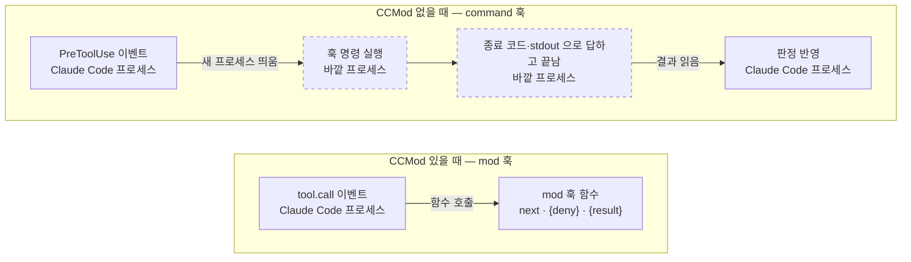
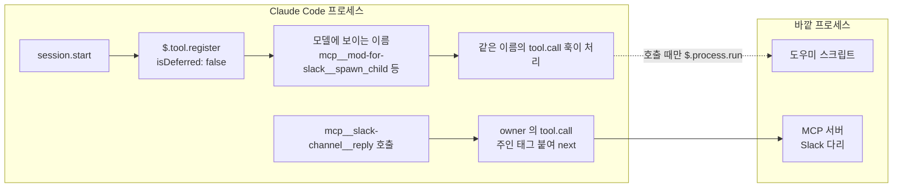

# 개발자 안내

[English](developers.en.md) · [처음 쓰는 분 안내(README)](../README.md) · [설치 안내](install.md)

이 문서는 mod-for-slack 을 고쳐 쓰거나 늘리려는 개발자를 위한 것입니다. 설치와 처음 쓰기는 [README](../README.md) 와 [설치 안내](install.md) 를 보세요.

## 두 층

- **Claude Code mod** — Claude Code 의 보이는 모습과 동작을 바꾸는 플러그인입니다. 플러그인의 `hooks/hooks.json` 에 `modules` 키가 있고 그것이 가리키는 모듈(`register.js`)이 `register(on)` 을 내보내면 mod 가 됩니다. 처리기는 사건(`tool.call` · `prompt.submit` · `turn.complete` · `ui.render` · `session.*` 등)에 걸리고, 넘겨받는 `$`(mods API)로 칸·띠·상태 줄·알림(`$.ui`), 명령(`$.command`), 도구(`$.tool`) 등을 씁니다. 터미널 Claude Code 2.1.287 이상. 공식 문서: [개요](https://code.claude.com/docs/en/plugins/mods/overview.md) · [API](https://code.claude.com/docs/en/plugins/mods/api.md) · [참고](https://code.claude.com/docs/en/plugins/mods/reference.md).
- **mod-for-slack** — 위 틀로 만든 플러그인 하나(`slackmod/app/mods-harness`)와, 그것을 Slack 에 잇고 설치·켜기를 맡는 묶음입니다.

mods API 의 전체 타입은 저장소에 없습니다. Claude Code 가 `--plugin-dir` 로 플러그인을 실을 때 그 플러그인의 `.claude-plugin/types/claude-code/index.d.ts` 로 써 줍니다. 저장소의 `types/index.d.ts` 는 이 플러그인이 쓰는 상태 키(`mh.*`)만 적은 작은 파일입니다.

## CCMod 가 훅과 MCP 같은 도구를 더 잘 돌게 하는 원리

공식 문서의 정의부터 봅니다([개요 «Compare mods, settings hooks, skills, and MCP servers»](https://code.claude.com/docs/en/plugins/mods/overview.md)).

| | 정의(공식 문서) |
|---|---|
| 설정 훅 | 수명 주기 이벤트에 Claude Code 가 돌리는 셸 명령 · HTTP 요청 · 프롬프트 |
| MCP 서버 | Claude 에게 도구를 주는 바깥 프로세스 · 서비스 |
| mod | Claude Code 가 자기 프로세스 안에서 부르는 플러그인 함수 |



mod 는 Claude Code 가 자기 프로세스 안에서 부르는 플러그인 함수입니다(공식 정의). 위아래 두 줄은 도구 호출 직전 검사라는 같은 일을 두 방식으로 그린 것이고, 아래 줄이 mod 의 기본 꼴입니다. mod-for-slack 은 여기에 더해 `src/hooks-port` 관문이 도구 호출마다 `$.process.run` 으로 파이썬 실행기를 부릅니다. 그 부름은 mod 의 `tool.call` 안, 곧 사용자·프로젝트 설정 `PreToolUse` 보다 앞에서 일어나고 세션 대화를 입력으로 받습니다(관리 설정 `PreToolUse` 는 예외 · 아래 «순서»·«과장하지 않을 것»). 줄 길이는 거치는 자리 수일 뿐 지연 수치가 아닙니다. 아래 두 그림이 훅 쪽과 도구 쪽을 한 번 더 자세히 보여 줍니다.

### 훅 쪽 차이

- **결과의 폭** — 설정 훅은 진행 여부 · 인자 · 결과 · 덧붙일 문맥을 바꿉니다. mod 훅은 `next(e)` 로 지켜보거나 바꾼 `e` 를 넘기고, `{deny}` 로 막고, `{result}` 로 도구를 돌리지 않고 대신 답합니다(Observe · Rewrite · Answer · [개요](https://code.claude.com/docs/en/plugins/mods/overview.md)).
- **볼 수 있는 것** — 훅 안에서 `$.session.messages()` 로 대화(최신 4,096건)를 꺼냅니다([API](https://code.claude.com/docs/en/plugins/mods/api.md) · 개수 한도는 [참고 «Limits»](https://code.claude.com/docs/en/plugins/mods/reference.md)). 한 모듈의 훅들은 변수를 함께 써서, 한 훅이 센 것을 다른 훅이 화면에 그립니다.
- **순서** — mod 의 `tool.call` 은 설정 `PreToolUse` 보다 앞에 섭니다. 단, 조직 관리 설정의 `PreToolUse` 는 mod 보다 먼저 돌아갑니다. mod 가 `next` 를 부르지 않고 답하면 그 뒤 설정 훅은 돌지 않습니다. `tool.check` 는 그 둘 뒤입니다([이벤트 «Where settings hooks run in the order»](https://code.claude.com/docs/en/plugins/mods/events.md) · [참고](https://code.claude.com/docs/en/plugins/mods/reference.md)).
- **실패** — 예외를 던진 훅은 건너뜁니다. 훅 실행 한도는 10초이고, `next` · API 호출을 기다리는 시간은 세지 않습니다([참고](https://code.claude.com/docs/en/plugins/mods/reference.md)).

```mermaid
flowchart LR
  subgraph CC["Claude Code 프로세스"]
    C["모델의 도구 호출"] --> MH{"mod tool.call 훅<br/>hooks-port · 모든 도구"}
    S["$.session.messages()<br/>훅끼리 공유 변수"] -.-> MH
    MH -- "next(e) · 바꾼 e" --> PT["설정 PreToolUse<br/>셸 명령"]
    MH -- "{result}" --> ANS["도구 대신 답"]
    MH -- "{deny}" --> DEN["거절"]
    PT --> TC["tool.check"] --> RUN["도구 실행"]
  end
  subgraph EXT["바깥 프로세스"]
    PY["python 훅 실행기"]
  end
  MH -. "$.process.run · 매 호출" .-> PY
```



### 도구 쪽 차이

- `$.tool.register` 는 `session.start` 에서 도구를 등록하고, 첫 프롬프트 전에 끝납니다. Claude 에겐 MCP 와 같은 이름꼴 `mcp__<플러그인>__<이름>` 으로 보이고, 호출은 같은 이름의 `tool.call` 훅이 처리합니다. 상주 서버도, 연결 단계도 없습니다. `isDeferred: false` 면 도구 검색에 밀리지 않고 처음부터 실립니다([API «Add a tool»](https://code.claude.com/docs/en/plugins/mods/api.md)).
- 바깥 MCP 도구 호출도 `tool.call` 로 받아 고쳐 쓸 수 있습니다.



### mod-for-slack 코드에서

아래 경로는 플러그인 폴더 `slackmod/app/mods-harness/` 기준입니다. 도구 이름 앞부분은 폴더 이름이 아니라 plugin.json 의 이름(`mod-for-slack`)입니다.

- **손님 차례 거절** — `src/session/index.js` 의 `tool.call` 은 손님 글이 들어온 본 턴이면 허용 목록 밖의 도구를 `{deny}` 로 그 자리에서 거절합니다. 허용 목록은 `Read` · `Glob` · `Grep` · `ToolSearch` · Slack 답 · 반응입니다. 하위 세션의 Slack 도구는 자기 스레드에만 쓰게 막습니다.
- **관문(옛 훅 검사 자리)** — `src/hooks-port/index.js` 의 `tool.call` 은 정규식 `/^/` 로 모든 도구에 걸리고, 설정 `PreToolUse` 보다 먼저 섭니다. 매 호출 `$.process.run` 으로 파이썬 훅 실행기를 부르고, 정책이 원하면 `$.session.messages()` 도 실어 보냅니다. 실행기가 돌려준 결과를 `{deny}` 또는 덧붙일 문맥으로 합칩니다. 공개판이 그 자리에 싣는 검사는 `slackmod/hooks/pass.sh`(모두 통과) 하나입니다.
- **바깥 MCP 고쳐 쓰기** — `src/owner/index.js` 가 `mcp__slack-channel__reply` 의 `tool.call` 에서 주인 DM 스레드 답에 주인 태그를 붙여 `next({...e, text})` 로 넘깁니다. 설정 이름은 `owner_tag` 이고 기본으로 켜져 있습니다.
- **도구** — `spawn_child` · `list_children` · `close_child` · `send_to_child` · `report_to_parent` · `board_post` · `progress_line` 등은 `src/session/index.js` · `src/tools/index.js` 의 `session.start` 안에서 `$.tool.register` 로 등록하고, 모두 `isDeferred: false` 로 둡니다. 처리 함수는 불렸을 때만 `$.process.run` 으로 도우미를 부릅니다.

### 과장하지 않을 것

- 지연 수치(«N배» · μs)는 공식 문서에 없고, 우리도 재지 않았습니다. 우리 관문은 프로세스를 없앤 것이 아닙니다. 파이썬 실행기는 여전히 호출마다 돌아갑니다. 바뀐 것은 자리(설정 훅 앞) · 입력(세션 대화) · 결과 합치기입니다.
- Codex 등 다른 클라이언트도 쓰는 도구 · 외부 SDK · 오래 붙어 있는 연결은 MCP 로 둡니다. mod 도구는 그 Claude Code 세션 안에서만 보입니다.
- mod 는 샌드박스 밖에서 사용자 권한 전부로 돌아갑니다. 터미널에서는 v2.1.287 이상에서 돌고, 데스크톱 WSL 세션에서는 훅이 돌지 않습니다([개요 «Where mods run» · «Turn mods on or off»](https://code.claude.com/docs/en/plugins/mods/overview.md)).

## 폴더 구조

| 자리 | 무엇 |
|---|---|
| `install.sh` | 입구. 필요한 프로그램을 점검하고 Claude Code 를 설치 마법사(`setup/`)와 함께 엽니다(`--section` · `--resume` · `--answers`). |
| `setup/` | 설치 마법사 플러그인(이름 `mods-setup` · 명령 `/mods-setup:setup`). 스킬 `mods-setup` · `mods-doctor` · `bot-interview`, 도우미 `lib/`, 시험 `tests/`. |
| `slackmod/` | 설치되는 묶음(이름은 기존 설치를 위해 옛 이름 그대로). 아래 표. |
| `rules/` | 봇 운영 규칙 세 묶음(Claude Code · Codex · 일반판). 규칙이 부르는 도구 스크립트는 들어 있지 않습니다. |
| `docs/` | 설치 안내 · Slack 앱 안내서 · 이 문서. |

`slackmod/` 안:

| 자리 | 무엇 |
|---|---|
| `install.sh` | 설치기. `~/.slackmod` 아래에 깔고, 바꾼 것을 기록해 `slackmod undo` 로 되돌릴 수 있게 합니다. 두 번 돌려도 결과가 같습니다. |
| `bin/slackmod` | 켜기·끄기·상태 명령(`start` · `stop` · `status` · `attach` · `open` · `set-token` · `set-judge-key` · `set-effort` · `effort` · `undo` · `check-windows` · `room` · `board`). |
| `lib/slackmod_config.py` | 설정 파일을 읽어 검사하고 봇마다 켜기 파일을 만드는 곳. |
| `lib/record.py` | 설치 기록과 되돌리기. |
| `lib/route_judge.py` | 하위 라우터의 동봉 판정기(선택 · 아래 «하위 세션과 하위 라우터»). |
| `lib/rooms.py` | 프로젝트 방 만들기(`slackmod room`) · 웹 현황판 설정과 열쇠 만들기(`slackmod board`). |
| `app/mods-harness` | Claude Code mod 플러그인(아래). |
| `app/channel-server` | Slack 다리(Slack ↔ 봇 창). |
| `hooks/pass.sh` | 도구 호출마다 거치는 관문 자리(지금은 모두 통과). |
| `templates/` | 봇 규칙(본 세션 계약 · 하위 없는 판), 도움말 스킬 `slackmod-help`, 빈 노트 폴더 틀. |
| `README.md` | 묶음만 따로 받아 손으로 설치할 때의 안내와 «안 되는 때». |
| `MANIFEST.txt` · `SHA256SUMS` | 묶음을 만든 원본 커밋 · 고정한 Claude Code 판 · 파일 확인 값. |

플러그인 `app/mods-harness` 는 `hooks/hooks.json` → `register.js` 로 일곱 갈래를 싣습니다: 설정 읽기 · 관문(훅 실행기) · 세션(스레드마다 하위 세션) · 화면(띠와 현황판) · 도구 · 기억 · 주인 태그. 도구: 봇 본 세션 = `spawn_child` · `list_children` · `close_child` · `send_to_child` · `board_summary` · 하위 세션 = `report_to_parent` · `ask_sibling` · `answer_sibling` · `board_post` · `board_read`(하위 라우터를 켜면 `not_mine` 도 · 깊이가 남으면 `spawn_child` 등도) · 둘 다 = `progress_line`. 하위 세션 쓰기를 끄면(`children: false`) 본 세션의 이 다섯 도구는 실리지 않습니다.

## 켜질 때 무엇이 도나

`slackmod start <봇>` 은 봇 이름의 세션에 창 두 개를 엽니다.

- `bridge` — Slack 다리(`app/channel-server`). 기록은 봇의 `slack/server.log`.
- `main` — Claude Code. 환경 변수 `MODS_HARNESS_BOT` · `MODS_HARNESS_SESSION_ID`(새 값) · `MODS_HARNESS_CONFIG`(그 봇의 `harness.json`)를 두고, `--plugin-dir app/mods-harness` · `--mcp-config` · `--append-system-prompt-file`(봇 규칙) · Slack 채널 서버를 싣고, 봇 작업 폴더에서 umask 077 로 돌아갑니다.

herdr 안에서는 세션 대신 herdr 작업공간 하나에 탭 두 개로 엽니다(`--backend auto|tmux|herdr`).

봇마다 설치기가 만드는 파일(`~/.slackmod/bots/<봇>/`): `harness.json`(플러그인 설정) · `mcp.json` · `launch.sh`(켜기 값 · 나만 읽기) · `slack/.env`(열쇠 · `slackmod set-token` 으로만 넣음).

## 설정

설정 파일 하나 = `~/.slackmod/config.json`(본보기 `slackmod/config.example.json`). 고친 뒤 `bash install.sh` 를 다시 돌리면 봇마다 파일이 다시 만들어집니다.

- 꼭 있는 칸: `schema` · `slack`(채널 · 주인) · `bots`(1~4개) · `aliases` · `permission` · `child`(하위 세션 모델·생각 깊이·디스크/메모리 여유 문턱).
- 고를 수 있는 칸: `mode` · `wiki` · `memory_setup` · `browser` · `help_skill` · `children` · `children_open` · `owner_tag` · `window_backend` · `router` — 뜻은 `slackmod/lib/slackmod_config.py` 맨 위 설명에 있습니다.
- 봇마다: `name` · `work_dir` · `slack_bot_user_id` · `model` · (선택) `effort` · `projects`(작업 폴더) · `extra_channels` · `extra_env`(허용된 이름만 · 비밀 같은 이름은 봇 `.env` 로만).

`harness.json` 은 손으로 고치지 않습니다(설치기가 다시 씀). 큰 묶음: `hooks`(관문) · `memory` · `session`(기본 모델 · 주인 · 하위 세션) · `ui`(화면 이름 `system_name`) · `owner`.

## 설치 마법사의 단계

`install.sh` 는 필요한 프로그램(Claude Code · node 20+ · python3 · git · 다중 창 도구)을 점검하고, 빠진 것은 설치 명령만 보여 줍니다(관리자 권한 명령을 스스로 실행하지 않습니다). 그다음 Claude Code 가 설치 마법사(`/mods-setup:setup`)로 바로 시작합니다. 마법사 본체는 `setup/skills/mods-setup/SKILL.md` 입니다.

0. 컴퓨터를 먼저 살펴봅니다(읽기만): 컴퓨터 종류 · 명령창 · Claude Code 버전 · 기본 기억 · 노트 앱 폴더 · 이미 깔린 스킬과 추가 기능. 쓰던 Claude Code 대화 기록은 **미리 알린 뒤** 숫자만 셉니다(자주 일한 폴더 · 자주 쓴 도구 — 글 내용은 저장하지도 보여 주지도 않음 · «읽지 않기»를 고를 수 있음).
1. 이미 쓰던 설정(Claude Code · Codex · 다른 봇)을 찾아 보여 주고, 가져올지 묻습니다. 가져올 때는 **사본**만 별도 폴더로 옮깁니다 — 원본은 건드리지 않습니다.
2. 모드를 고릅니다: 빠른(추천 기본값) · 전체(칸마다 고르기) · 빈 판(설치만). 빠른 모드도 «추천 스킬 · 작업 폴더 · 기억도 물어볼까요?» 한 번 묻습니다.
3. 창 도구 · Slack 연결 · 위키 폴더 · MCP · 코덱스 · 점검 스킬 · 브라우저 · 메모리 · 하위 세션 쓰기 · 하위 라우터를 고릅니다(빠른 모드는 Slack 연결 · 하위 세션 쓰기 · 하위 라우터만 묻습니다).
   그 밖의 칸: **추천 스킬**(모두에게 같은 기본 묶음 — 기억 잇기 · 자료 찾기 · «무엇을 쓰면 되나요?» 도움말 · 점검과 되돌리기 — 그 위에 우리 목록과 Claude Code 공식 추가 기능 목록에서 조건 맞는 것만 권함 · 이미 있는 것은 뺌 · 고른 것만 넣음) · **기억**(기본 기억 + 노트 앱 폴더 · 둘 다 없으면 빈 노트 폴더 틀을 깔아 줌 · 바깥 기억 서비스는 연결 시험이 통과할 때만 이음) · **작업 폴더**(선택 — 평소 일하는 폴더를 봇에게 이어 줌 · 이은 폴더 밖은 열지 않음) · **생각 깊이**(모든 봇 한 번에 또는 봇마다) · **쓸 수 있는 모델**(이름 확인 + 짧은 실제 호출 · 답이 없으면 «확인 안 됨»).
4. 봇마다 이름과 성격을 짧은 인터뷰로 정하고, 넣기 전에 점검합니다. 가져올 봇이 없으면 역할 기본값 셋(총괄 · 감시/일정 · 조사)으로 시작합니다.
   하시는 일을 다섯 가지 묻습니다 — «나중에»를 고르면 미뤄 두었다가 이어 묻습니다.
5. 고른 것을 **한 번에** 설치하고(설치마다 «무엇을 바꿨는지» 기록 → 방금 설치를 되돌릴 수 있음), 점검 표를 보여 준 뒤, 새 터미널 창을 열어 토큰을 넣고 봇을 켭니다. 처음 켤 때 봇 창에 확인 화면이 뜹니다 — 고르는 법은 [SUPPORT.md](../SUPPORT.md) 의 «처음 켤 때 봇 창의 확인 화면» 줄.
6. Slack 을 «지금 연결»로 골랐고 이 컴퓨터에 브라우저 도구 Aside 가 있으면, 3번에서 Slack 앱 만들기를 브라우저로 대신할지 함께 묻고, 설치가 끝난 뒤 이때 브라우저로 만듭니다(전부 대신 · 앱 만들기만 대신 · 안내서 보고 직접 — [Slack 앱 안내서](slack-app.md) 맨 위).
7. 미룬 칸이 있으면 봇 폴더에서 이어 할 Claude Code 창을 열지 묻습니다.
8. 설치가 끝났고 봇이 있으면 웹 현황판을 지금 켤지 묻습니다(기본 «나중에»). 켜도 처음 열 주소(`slackmod board url`)는 마법사가 부르지 않습니다 — 열쇠가 든 주소라 대화에 남기지 않으려는 것입니다.

칸 하나만 다시 하려면: Claude Code 에서 `/mods-setup:setup --section slack` 처럼 부릅니다. 미뤄 둔 칸만 이어 하려면 터미널에서 `bash install.sh --resume` — Slack 을 잇기 전에도 됩니다(마법사가 끝날 때 그 봇 폴더에서 Claude Code 창을 열어 이어 하게 할 수도 있습니다). 봇 생각 깊이는 나중에 `slackmod set-effort <봇|all> <low|medium|high|xhigh|max|default>` 로 바꾸고 그 봇을 껐다 켭니다.

## 주인과 손님

- **손님 글 제한** — 손님 글에는 대화와 답만 합니다. 손님 글이 들어온 턴에는 읽기와 Slack 답·반응 말고는 도구가 스스로 거절하고, 뒤 턴에도 손님 글의 문장(30자 이상)을 그대로 담아 하위 세션에 넘기는 일은 거절합니다. 이 제한은 mod 가 도구 호출마다 끼어들어 지킵니다.
- **한계** — 봇이 손님 말을 바꿔 써서 넘기는 것까지는 도구로 막지 못합니다. 그 부분은 봇 규칙(손님 글은 하위 세션으로 옮기지 않는다)으로 지킵니다.
- **주인 태그(기본 켬)** — 주인 사용자 ID(`slack.owner_user_id`)가 있으면, 봇이 주인 DM 의 스레드에 답할 때 글 맨 앞에 주인 태그를 붙입니다(이미 있으면 그대로 · 최상위 글 · 채널 · 다른 사람 DM 은 손 안 댐). 끄려면 설정에 `"owner_tag": false` 를 넣고 `bash install.sh` 를 다시 돌립니다.
- **봇끼리** — 봇끼리 스레드에서 대화할 수 있습니다. 설정 `bots[].slack_bot_user_id` 에 두 봇 ID 를 모두 채우면 서로 허용되고, 봇이 쓴 글은 받는 봇을 `@이름`(멘션)으로 불러야 전달됩니다. 봇 사이 DM 은 안 됩니다. 자세한 Slack 쪽 설정은 묶음 안 `slackmod/README.md` 의 «Slack 앱 확인»에 있습니다.

## 하위 세션과 하위 라우터

- **하위 세션 쓰기** — 여러 단계가 걸리는 일은 그 스레드 전용 하위 세션을 새 창에 열어 맡깁니다. 설치 마법사의 «하위 세션 쓰기» 를 끄면(`children: false`) 하위 없이 봇 본 창에서 합니다.
- **하위 세션의 기억** — 하위 세션은 Claude Code 의 기억(`~/.claude/projects/…/memory` · `~/.claude/CLAUDE.md` · 봇 폴더의 `CLAUDE.md`)에 직접 쓰지 못합니다. 하위는 결과만 보고하고, 남길지는 본 봇이 정합니다.
- **하위 라우터(선택 · 기본 끔)** — 주인이 봇에게 쓴 글이 다른 스레드에서 일하는 하위 세션의 일이면, 판정 모델이 그 하위를 골라 같이 넘겨 줍니다(봇도 그 글을 그대로 받음). 설정 `"router": {"mode": "off" | "shadow" | "on", "judge": "bundled" | ["명령", "낱말", …]}` — `shadow` = 고르기만 하고 기록 · `on` = 고른 하위에게도 넘김. `children: false` 면 쓰지 않고, 주인 사용자 ID 가 없으면 켜도 돌지 않습니다.
- **동봉 판정기(`"bundled"`)** — `lib/route_judge.py` 가 판정 1번에 Claude API 를 1번 부릅니다. 주인이 봇에게 쓴 글(최대 4,000자)과 하위 세션 설명이 그 API 로 나갑니다. 시간 한도 5초(넘으면 판정 없이 봇이 받음). 키는 `slackmod set-judge-key <봇>` 으로 넣습니다(화면에 안 보임 · 봇의 slack 폴더 `route-judge.key` 0600 · 봇 환경과 실행 줄엔 안 들어감).
- **내 판정 명령** — 표준 입력 JSON `{v, boundary:"route1", body, dm, criteria: {"부모": …, "하위 A": …}, timeout_s}` → 표준 출력 한 줄 `{"ok": true, "probs": {라벨: 0~1, …}}`(못 고르면 `{"ok": false, "reason": "…"}`) · 시간 한도 1.5초. 넘기는 규칙(고정): 한 하위 ≥ 0.85 · 둘째 ≤ 0.10 · 부모 ≤ 0.10.

키 파일에 대한 주의는 아래 «알아 둘 점»에 있습니다.

## 웹 현황판 안쪽

현황판은 봇들과 프로젝트 방을 이 컴퓨터 브라우저 한 장에 보여 줍니다(읽기 전용 · 설정 쓰기 0). 켜고 끄는 법은 [설치 안내의 «현황판 켜기»](install.md#현황판-켜기-선택)에 있습니다.

- **서버** — `slackmod board start` 는 설치된 `app/mods-harness/tools/web-board/server.mjs` 를 tmux 세션 `slackmod-board` 에서 켭니다(tmux 가 없으면 백그라운드). 서버 기록은 `~/.slackmod/web-board/server.log`.
- **열쇠와 주소** — 설정·열쇠·봇 명부는 `~/.slackmod/web-board/` 에 있습니다. 열쇠 `web.key` 는 처음 켤 때 이 컴퓨터에서 만들고(0600 · 나만 읽기) 다시 켜도 그대로입니다. 주소는 `127.0.0.1` 에만 열립니다(같은 망의 다른 컴퓨터에서는 안 열림). 기본 포트는 8794 이고 `--port` 로 바꿉니다. `slackmod board url` 로 연 브라우저는 30일 동안 기억해 그동안은 `http://127.0.0.1:8794/` 만으로 열립니다.
- **방 폴더** — `slackmod room new` 는 `~/.slackmod/rooms/<날짜>-<이름>/` 에 네 파일(배경 · 계획 · 진행 기록 · 결과)을 만듭니다. 계획 파일 `01-spec.md` 의 «의존 그래프»는 목표와 다음 일로 처음부터 채워집니다. `--thread <스레드 링크>` 를 붙이면 현황판에서 그 스레드로 바로 갑니다. 현황판은 최근 31일 방 40개까지 읽습니다.
- **그래프 상태 표시** — 일이 움직이면 봇(또는 사람)이 그 방 `01-spec.md` 의 노드 글 맨 앞 상태 표시를 바꿉니다: ✅ 끝 · 🔄 하는 중 · ⏳ 기다림 · ❌ 막힘 · ❓ 사람 판단. 노드는 `X["⏳ 할 일"]`, 순서는 `A --> X`.
- **«연결 전» 칸** — 사용량 한도 · 승인 대기처럼 mod-for-slack 이 읽지 않는 칸은 «연결 전»으로 보입니다(0 으로 지어 보이지 않음).
- **다시 설치한 뒤** — `slackmod board stop` → `slackmod board start` 로 새 판을 읽힙니다.
- **되돌리기와의 관계** — 현황판 폴더(`~/.slackmod/web-board`)와 방 폴더(`~/.slackmod/rooms`)는 사용자 자료라 `slackmod undo` 가 지우지 않습니다.

## 고쳐 쓰고 늘리기

- **봇 규칙** — 봇 작업 폴더의 `.claude/rules/` 에 md 파일을 둡니다(설치기가 만든 `slackmod-projects.md` · `slackmod-memory.md` 는 설치기가 다시 씁니다). 저장소의 `rules/` 는 참고용 세 묶음입니다.
- **스킬** — 봇 작업 폴더의 `.claude/skills/<이름>/SKILL.md` 또는 사용자 폴더 `~/.claude/skills/`. Claude Code 의 보통 스킬 방식 그대로입니다.
- **다른 채널** — 봇의 `extra_channels` 에 넣으면 Slack 채널 서버 뒤에 함께 실립니다.
- **관문** — `slackmod/hooks/pass.sh` 를 고친 뒤 `bash install.sh` 를 다시 돌리면 새 확인 값이 기록됩니다. 설치된 사본만 고치면 확인 값이 안 맞아 도구 호출이 막힙니다(점검 표가 알려 줌).
- **마법사 칸 다시 하기** — `/mods-setup:setup --section <칸>` 또는 `bash install.sh --section <칸>`. 칸 = `mux` · `slack` · `wiki` · `mcp` · `codex` · `doctor` · `browser` · `memory` · `children` · `router` · `bots`.
- **mod 를 직접 고치기** — `slackmod/app/mods-harness/src/` 를 고친 뒤 `claude plugin validate slackmod/app/mods-harness` 로 확인하고 봇을 다시 켭니다.

## 시험

이 저장소에 들어 있는 시험은 `setup/tests/` 입니다.

```bash
bash setup/tests/run-all.sh          # 전부 · 파일마다 rc 와 PASS/FAIL 수
bash setup/tests/run-all.sh m4       # 이름이 m4 로 시작하는 것만
MUTATE=1 bash setup/tests/run-all.sh # 검사를 하나씩 꺼 보며 시험이 잡는지도 셈
```

손으로 돌리는 것(`m3-bundle-layout` · `m3-live-wizard` · `m3-g34-live`)은 묶음에서 빠집니다. 묶음 만들기·설치기 계약·흔적 검사 시험은 공개 저장소에 들어 있지 않아 `run-all.sh` 가 건너뜁니다.

## Claude Code 판

묶음은 Claude Code 판 하나에 맞춰 시험합니다(`slackmod/app/mods-harness/.claude-code-version`). 다른 판이면 설치기가 경고와 맞추는 명령만 보여 주고 막지는 않습니다. 봇 창은 자동 업데이트를 끈 채 돌아갑니다.

## 텔레그램·디스코드 채널 플러그인과 겹칠 때

Claude Code 의 공식 채널 플러그인(텔레그램 · 디스코드 · iMessage · fakechat)을 계정 전체에서 켜 두었다면, mod-for-slack 봇이 켜질 때 그 플러그인도 같이 켜져 기존 봇과 같은 토큰을 다툽니다(텔레그램은 기존 연결이 끊깁니다). 점검 표 [8] 칸이 그런 봇과 플러그인을 알려 줍니다. 봇이 그 채널을 일부러 쓰는 것이면 설정(`~/.slackmod/config.json`)의 그 봇 `extra_channels` 에 넣고 `install.sh` 를 다시 돌리세요(그러면 [8] 이 세지 않습니다). 아니면 적힌 대로 그 봇 폴더의 `.claude/settings.local.json` 에서 끄세요 — 그 폴더에서 여는 Claude 창은 모두 꺼지므로, 봇 폴더를 다른 작업 창과 같이 쓰고 있다면 그쪽도 꺼집니다.

## 알아 둘 점 (미리보기 판)

- **봇 창의 파일 권한:** 봇 창은 umask 077 로 돌아갑니다. 봇이 Bash·git·npm 으로 만드는 파일과 폴더도 기본이 «나만 읽기»(600/700)라서, 팀 공유 폴더·웹 서버·Docker 볼륨처럼 다른 계정이 읽어야 하는 곳에서는 그 파일만 권한을 넓혀 주세요(`chmod`). 봇이 꺼진 뒤 같은 창에 남는 셸도 같은 설정을 이어받습니다.
- **하위 라우터의 동봉 판정기(선택 · 기본 끔):** 켜면 판정 1번마다 주인이 봇에게 쓴 글(최대 4,000자)과 하위 세션 설명이 Anthropic API(Claude API)로 나갑니다. 키는 `slackmod set-judge-key <봇>` 으로 넣습니다 — 봇 환경에는 들어가지 않지만, 같은 계정의 프로그램(봇의 Bash 포함)은 그 키 파일을 읽을 수 있으니 판정 전용으로 사용 한도를 건 키를 쓰세요. 라우터를 꺼도 키 파일은 남습니다 — 지우려면 그 봇의 `~/.slackmod/bots/<봇>/slack/route-judge.key` 를 지우세요.
- **아주 바쁜 컴퓨터:** 봇의 도구 호출마다 앞에서 도는 관문이 시간 한도(7초)를 넘기면 그 호출은 막힙니다(통과만 시키는 관문이어도 그렇습니다). 부하가 아주 높을 때 도구 호출이 가끔 막히면 다시 시도하면 됩니다 — 다음 판에서 고칩니다.

## 이름에 대해

제품 이름은 mod-for-slack 입니다. 기존 설치가 그대로 돌도록 명령 `slackmod` · 설치 폴더 `~/.slackmod` · 저장소 안 폴더 `slackmod/` · 셸 설정 칸 표식 `# >>> slackmod >>>` · 환경 변수 `SLACKMOD_*` 는 옛 이름 그대로입니다. 이미 만든 Slack 앱 이름(«SlackMod …»)도 바꾸지 않아도 됩니다. 플러그인 이름은 `mod-for-slack` 입니다 — Claude Code 는 플러그인의 상태 줄과 알림 앞에 이 이름을 붙이고(화면의 알림 줄은 «mod-for-slack:» 로 시작), 봇이 받는 도구 이름도 `mcp__mod-for-slack__…` 로 시작합니다. 이 이름은 배포 묶음을 만들 때 플러그인 사본의 설정에만 써 넣습니다. 그래서 플러그인 폴더 `app/mods-harness` · 환경 변수 `MODS_HARNESS_*` · 기록 폴더 `~/.mods-harness` 는 옛 이름 그대로입니다. 플러그인 이름이 바뀐 판으로 올리면 켜져 있던 봇은 한 번 껐다 켜야 새 이름으로 돌아갑니다(`slackmod stop all` → `slackmod start all`).

## 규칙과 관련 저장소

이 저장소가 봇 운영 규칙 원본이 있는 곳입니다. [rules/](../rules/) 에 세 묶음이 있습니다 — Claude Code 봇용(`rules/claude-code/`) · Codex 봇용(`rules/codex/`) · 특정 봇 이야기를 뺀 일반판(`rules/general/`). 묶음마다 사본과 설치기를 담은 관련 저장소가 하나씩 있고, 그 저장소들은 맨 위 안내 줄로 이곳을 가리킵니다. 어느 저장소에 어느 묶음의 사본이 있는지는 [rules/README.md](../rules/README.md) 의 표에 있습니다.

### 최근 바뀐 것

- 2026-11 · 규칙 원본을 이 저장소로 옮겼습니다. 세 저장소의 기본 브랜치에 2026-10-25~27 규칙 갱신(웹 조사는 자체 도구 먼저 · 공개물은 화면에 그려진 줄바꿈까지 점검 · 보안 검토 방식 · 프로세스는 하나씩 확인하고 끄기)을 함께 반영했습니다.
