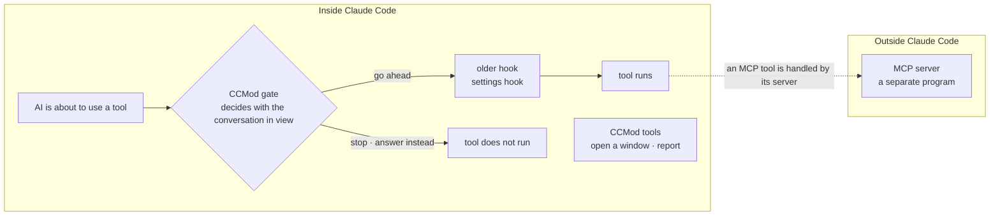

# Install guide

[한국어](install.md) · [For first-time users (README)](../README.en.md) · [Developer guide](developers.en.md)

This page walks through installing mod-for-slack for the first time, one step at a time. For what it is and first use, see the [README](../README.en.md).

## Before you install — what a CCMod does, at a glance

mod-for-slack works by adding a CCMod (Claude Code mod) to Claude Code. A CCMod is not just decoration for the screen. Because it runs as functions "inside" Claude Code, it can put a gate in front of the older hooks, one that looks at the conversation right before the AI uses a tool. It can also register tools directly, with no separate server (MCP server) ([official docs](https://code.claude.com/docs/en/plugins/mods/overview.md)).



- Once installed, this CCMod is on for every bot. On a turn where a message from a guest (anyone but the owner) came in, it refuses on the spot every tool except reading and Slack replies. Editing files and running commands are blocked.
- The tools for opening sub-sessions and reporting back are loaded at the same time: open a new window, report, post to the board, and so on. A sub-session is a new Claude Code window that takes on part of the work.
- What changes is less about speed and more about "where it stands and what it can see". The plain explanation is in the [README, "CCMod is not just a nicer screen"](../README.en.md#ccmod-is-not-just-a-nicer-screen--how-it-makes-hooks-and-tools-work-better), and the code and sources are in the [developer guide](developers.en.md#how-a-ccmod-makes-hooks-and-mcp-style-tools-work-better).

## Before you start

- **Computer** — macOS · Linux · Linux inside Windows (WSL · Ubuntu). On Windows you work in an Ubuntu window, not in PowerShell. The checked status per environment is in the [support table (SUPPORT.md, Korean)](../SUPPORT.md).
- **Claude Code** — must already be installed (see «Install Claude Code first» below). With terminal Claude Code 2.1.287 or later, you do not need to switch the mod feature on separately.
- **Claude Code sign-in** — receiving Slack messages only works when you sign in with a claude.ai account or a Console API key. With a Bedrock · Google Cloud (Vertex) · Foundry sign-in, or a sign-in that goes through a proxy server, the bot does not receive Slack messages. In Team and Enterprise organizations, the organization Owner has to turn on «Organization settings → Claude Code → Channels».
- **Programs** — node 20 or later · python3 · git · a multi-window tool (one of tmux · cmux · herdr · tmux is the default). On Linux it also uses curl and uuidgen. If anything is missing, `install.sh` only shows the command to install it (it installs nothing itself and never runs admin-rights commands).
- **Slack** — a Slack workspace for the bot, and a browser signed in to it.

tmux is the official multi-window tool. With cmux and herdr, start tmux inside their window. herdr can also open sub-session windows directly as herdr tabs. Orca is being tried out.

## Install Claude Code first

This setup helper assumes **a computer that already has Claude Code**. Any terminal works (macOS Terminal · inside tmux · herdr · cmux) as long as Claude Code is installed.

- **Windows** — there is an all-in-one installer that installs Linux inside Windows (WSL · Ubuntu), Claude Code and tmux together. Its address: https://github.com/treylom/cc-codex-easyinstall The bots run inside that Ubuntu window. When the install is done, open «Ubuntu» from the Start menu and do the steps below in that window.
- **macOS · Linux · WSL** — the official one-liner (no admin rights): `curl -fsSL https://claude.ai/install.sh | bash` → open `claude` once in a new window and sign in.

## Download and the setup wizard

```bash
git clone <this repository's URL> mod-for-slack && cd mod-for-slack
bash install.sh
```

`install.sh` first checks the programs it needs. If something is missing, it shows the command to install it and stops — install it with that command, then run `bash install.sh` again.

Once the check passes, the **setup wizard** starts inside Claude Code. The first time, a «do you trust this folder?» window appears: arrow down to «Yes» and press Enter. Plain Enter picks «No, exit».

The wizard asks one thing at a time, in plain words. Roughly in this order:

1. **Whether to read your past conversation history** — if you say yes, it only counts (folders you worked in most · tools you used most). Message text is neither stored nor shown. You can choose «don't read».
2. **Whether to bring in settings you already use** — it shows the Claude Code · Codex · other bot settings it found in a table and asks whether to bring in copies (all · choose · none). The originals are not touched.
3. **Mode** — quick (recommended defaults) · full (choose every option) · blank (install only).
4. **Slack connection** — asks whether to connect now. If you do, it asks for the channel ID (starts with C) and the user ID (starts with U) of the person who will talk to the bot. Guest IDs are optional. It does not ask for the tokens here.
5. **Use sub-sessions · sub-session router** — asks whether longer work is handed to a new window per thread (on by default), and whether to use the optional feature that passes an owner message to the right sub-session (off by default).
6. **Other options** — in full mode, or if you choose «ask me», it also asks about the window tool · notes folder · recommended skills · work folders · memory · thinking depth · usable models and more.
7. **Bots** — you set each bot's name and personality. If there are no bots to bring in, it starts from three defaults (`lead` for leading · `watch` for watching and scheduling · `research` for research).
8. **Your work** — it asks five things so the bot can help well. Choose «later» to put them aside.
9. **Summary table** — it shows what you picked in one table and lets you choose «install / change / stop».
10. **Install and health-check table** — it installs at once and shows a health-check table with a result per item. Each install records what it changed, so you can undo the install you just did.
11. **Slack app** — if this computer has the browser tool Aside, it asks while you set up the Slack connection whether to create the Slack app through the browser for you. If you said yes, the browser does it at this point, after the install. Without Aside, follow the guide in «Create the Slack app» below.
12. **Terminal for the tokens** — a new terminal window opens where you enter the two tokens (not shown on screen), run `/login` if needed, and start the bots.
13. **Continue window · web board** — if you put sections aside, it asks whether to open a window to continue them, and whether to start the web board now (default «later»).

To change things later:

- Redo one section: call it in Claude Code like `/mods-setup:setup --section slack`.
- Continue only the sections you put aside: `bash install.sh --resume` in the terminal (works even before Slack is connected).
- Change a bot's thinking depth: run `slackmod set-effort <bot|all> <low|medium|high|xhigh|max|default>`, then turn that bot off and on.

## Create the Slack app

Each bot needs its own Slack app. The steps and screens, with pictures, are in [Create the Slack app and get its tokens](slack-app.en.md). The repository includes a file (a manifest) that fills in the app settings at once.

The two tokens (`xoxb-` · `xapp-`) are like passwords. Do not paste them into chats, Slack or AI conversations; put them straight in with `slackmod set-token <bot>` in a terminal.

## First check

1. Run `slackmod status` in the terminal. Each bot shows on/off · bridge · tokens · number of sub-session windows. You are fine when the token is not `missing` and the bot shows «켜짐» (on).
2. A bot started for the first time shows confirmation screens in its window and waits. Go in with `slackmod attach <bot>`. The folder-trust and bypass-permissions screens come once each, and the cursor sits on «No, exit». Arrow down to «Yes» and press Enter (plain Enter turns the bot off). The development-channels screen comes every launch, and `slackmod start` answers it for you. More detail is in the «처음 켤 때 봇 창의 확인 화면» line of [SUPPORT.md](../SUPPORT.md) (Korean).
3. If you are not signed in, run `/login` once in the terminal opened at the end of the install.
4. On WSL, run `slackmod check-windows` to make sure no window on the Windows side is running the same Slack app. If both are on at the same time, one side misses messages.
5. Send the bot a DM in Slack. When it answers, the install is done. How to use it is in [«First use» in the README](../README.en.md#first-use).

## After restarting the computer

The bots do not start by themselves (no auto-start is installed). If you restarted the computer or the multi-window tool (tmux etc.) was closed, run `slackmod start all` once in the terminal. The bot windows and the Slack bridges come back. Check with `slackmod status` («켜짐» = on, for each bot).

- To restart just one bot, type the bot's name (e.g. `lead`) in the terminal. If it is running, only that bot is stopped, started again as a new conversation, and you are taken into that bot's screen. Slack messages that arrive in the first 30 seconds or so after the start can be missed, so please send them again.
- Sub-sessions that were running at the time end too. A new message in that thread goes to the bot's main window.
- Schedules set inside a bot session (repeating jobs inside the session etc.) disappear with the session. Set them again.

## Turn on the web board (optional)

The web board shows what the bots are doing and how far each project has come, on one page in this computer's browser. It only shows things; it does not change settings.

- **Start** — `slackmod board start` in the terminal. If you chose «start now» at the end of the setup wizard, it is already on. The first start makes a board key on this computer (not the Slack tokens). It opens only in this computer's browser (other computers on the same network cannot open it).
- **Open it the first time** — run `slackmod board url` in the terminal and paste the address it prints into your browser. **The address carries the board key, so do not paste it into chats or Slack.** Once opened, that browser remembers it for 30 days, and in that time `http://127.0.0.1:8794/` alone opens it.
- **Stop · status** — `slackmod board stop` · `slackmod board status`. To change the port: `slackmod board start --port 8800`.
- **Make a project room** — for example: `slackmod room new website-renewal --goal "Launch the new homepage" --step "Get design drafts" --step "Move the content"`. The work graph starts filled from the goal and the next steps and is drawn on the board. If you work in a Slack thread, add `--thread <thread link>` and the board takes you straight to that thread. List the rooms with `slackmod room list`.
- **Update the graph** — as work moves, ask the bot «update this room's graph». How to edit it by hand is in [«Web board internals» in the developer guide](developers.en.md#web-board-internals).
- After reinstalling, run `slackmod board stop` → `slackmod board start` to turn it on again.

## When something goes wrong

- **`slackmod status` shows the token as `missing`** → put in the two tokens with `slackmod set-token <bot>`.
- **The bridge shows «없음» (none)** → go in with `slackmod attach <bot>`, press `Ctrl+b`, release, then `0`, and read the last line of the bridge window. Check the tokens · the channel ID · whether the app was invited to the channel.
- **The bot is on but does not answer** → the bot window may be waiting on a confirmation screen from «First check» above. Also check how you signed in («Claude Code sign-in» in «Before you start» above).
- **Tool calls are sometimes refused with «hook-timeout-or-interrupt»** → this happens when the computer is very busy. Try again.
- **A sub-session window does not open** → the bot's screen shows the reason as «spawn_child refused: …». It does not open one when free disk space is too low.
- **After restarting a bot, an old thread is refused with «already working … close_child»** → in that thread, ask the bot «look at list_children and close_child the sub-session that is gone», and a new one opens (left alone, it closes by itself after 60 minutes).
- **The board says it «did not start» («켜지지 않았습니다»)** → read the last line of `~/.slackmod/web-board/server.log`. If it says the key file permissions are too wide («거절: 열쇠 파일 권한이 넓음»), run `chmod 600 ~/.slackmod/web-board/web.key`. If the port is already in use, run `slackmod board start --port 8800`.

Other cases (for example every tool call refused with a checksum mismatch, «확인 값이 안 맞음») are covered in [«안 되는 때»](../slackmod/README.md#안-되는-때) in the bundle's own guide (Korean).

## Undo

How to undo just the install you did, or remove mod-for-slack completely, is in [«Undo» in the README](../README.en.md#undo).
