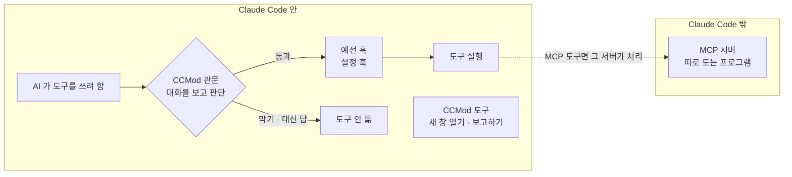

# 설치 안내

[English](install.en.md) · [처음 쓰는 분 안내(README)](../README.md) · [개발자 안내](developers.md)

이 문서는 mod-for-slack 을 처음 설치하는 순서를 한 단계씩 적은 것입니다. 무엇인지와 처음 쓰기는 [README](../README.md) 를 보세요.

## 설치하기 전에 — CCMod 가 하는 일 한눈에

mod-for-slack 은 Claude Code 에 CCMod(Claude Code mod)를 붙여서 돌아갑니다. CCMod 는 화면만 바꾸는 장식이 아닙니다. Claude Code «안»에서 함수로 돌기 때문에, AI 가 도구를 쓰기 직전에 대화를 보고 판단하는 관문을 예전 훅보다 앞에 세울 수 있습니다. 따로 도는 서버(MCP 서버) 없이 도구를 바로 등록할 수도 있습니다([공식 안내](https://code.claude.com/docs/en/plugins/mods/overview.md)).



- 설치가 끝나면 봇마다 이 CCMod 가 켜집니다. 손님(주인이 아닌 사람) 글이 들어온 차례에는 읽기와 Slack 답 말고는 도구를 그 자리에서 거절합니다(파일 고치기 · 명령 실행이 막힘).
- 하위 세션을 열고 결과를 보고받는 도구도 이때 함께 실립니다. 새 창 열기 · 보고하기 · 게시판 쓰기 같은 도구입니다. 하위 세션은 일을 나눠 맡는 새 Claude Code 창입니다.
- 달라지는 것은 속도보다 «어디에 서서 무엇을 볼 수 있느냐»입니다. 쉬운 설명은 [README «CCMod 는 화면만 바꾸는 게 아닙니다»](../README.md#ccmod-는-화면만-바꾸는-게-아닙니다--훅과-도구가-더-잘-도는-원리)에, 코드와 근거는 [개발자 안내](developers.md#ccmod-가-훅과-mcp-같은-도구를-더-잘-돌게-하는-원리)에 있습니다.

## 준비물

- **컴퓨터** — 맥 · 리눅스 · 윈도우 안 리눅스(WSL · Ubuntu). 윈도우에서는 PowerShell 이 아니라 Ubuntu 창에서 진행합니다. 환경마다 확인 상태는 [지원 표(SUPPORT.md)](../SUPPORT.md) 에 있습니다.
- **Claude Code** — 미리 깔려 있어야 합니다(아래 «Claude Code 먼저 깔기»). 터미널 Claude Code 2.1.287 이상이면 mod 기능을 따로 켤 필요가 없습니다.
- **Claude Code 로그인** — Slack 글을 받는 기능은 claude.ai 계정 로그인 또는 Console API 키일 때만 켜집니다. Bedrock · Google Cloud(Vertex) · Foundry 로그인이나 대리 서버를 거치는 로그인에서는 봇이 Slack 글을 받지 못합니다. Team·Enterprise 조직은 조직 Owner 가 «Organization settings → Claude Code → Channels» 를 켜야 합니다.
- **프로그램** — node 20 이상 · python3 · git · 다중 창 도구(tmux · cmux · herdr 중 하나 · 기본은 tmux). 리눅스는 curl 과 uuidgen 도 씁니다. 빠진 것이 있으면 `install.sh` 가 깔 명령만 보여 줍니다(스스로 깔지 않고, 관리자 권한 명령도 실행하지 않습니다).
- **Slack** — 봇을 둘 Slack 워크스페이스와, 거기에 로그인된 브라우저.

다중 창 도구는 tmux 가 정식입니다. cmux 와 herdr 는 그 창 안에서 tmux 를 켜면 됩니다. herdr 는 하위 창을 herdr 탭으로 직접 여는 방식도 됩니다. Orca 는 시험 중입니다.

## Claude Code 먼저 깔기

이 설치 도우미는 **Claude Code 가 이미 깔린 컴퓨터**를 전제로 합니다. 명령창이 무엇이든(맥 터미널 · tmux · herdr · cmux 창 안) 상관없고, Claude Code 만 깔려 있으면 됩니다.

- **윈도우** — 윈도우 안 리눅스(WSL·Ubuntu) · Claude Code · tmux 를 한 번에 깔아 주는 설치기가 있습니다. 주소: https://github.com/treylom/cc-codex-easyinstall 봇은 그 Ubuntu 창 안에서 돌아갑니다. 설치가 끝나면 시작 메뉴의 «Ubuntu» 를 열고, 아래 단계를 그 창에서 하세요.
- **맥 · 리눅스 · WSL** — 공식 한 줄(관리자 권한 없이): `curl -fsSL https://claude.ai/install.sh | bash` → 새 창에서 `claude` 를 한 번 열어 로그인.

## 내려받기와 설치 마법사

```bash
git clone <이 저장소 주소> mod-for-slack && cd mod-for-slack
bash install.sh
```

`install.sh` 는 먼저 필요한 프로그램을 점검합니다. 빠진 것이 있으면 깔 명령을 보여 주고 멈춥니다 — 그 명령으로 깐 뒤 `bash install.sh` 를 다시 치세요.

점검을 통과하면 Claude Code 안에서 **설치 마법사**가 시작됩니다. 처음 한 번 «이 폴더를 믿겠습니까?» 창이 뜨면 아래 화살표로 «Yes» 를 고른 뒤 Enter 를 누르세요. 그냥 Enter 는 «No, exit»(나가기)입니다.

마법사는 쉬운 말로 한 번에 한 가지씩 묻습니다. 대략 이런 순서입니다.

1. **쓰던 대화 기록을 읽을지** — 읽으면 숫자만 셉니다(자주 일한 폴더 · 자주 쓴 도구). 글 내용은 저장하지도 보여 주지도 않습니다. «읽지 않기»를 골라도 됩니다.
2. **쓰던 설정을 가져올지** — 이미 쓰던 Claude Code · Codex · 다른 봇 설정을 표로 보여 주고, 사본으로 가져올지 묻습니다(전부 · 고르기 · 안 가져오기). 원본은 건드리지 않습니다.
3. **모드** — 빠른(추천 기본값) · 전체(칸마다 고르기) · 빈 판(설치만).
4. **Slack 연결** — 지금 연결할지 묻습니다. 연결하면 채널 ID(C 로 시작)와 봇에게 말할 사람의 사용자 ID(U 로 시작)를 묻습니다. 손님 ID 는 선택입니다. 열쇠(토큰)는 여기서 묻지 않습니다.
5. **하위 세션 쓰기 · 하위 라우터** — 긴 일을 스레드마다 새 창에 맡길지(기본 켬)와, 주인 글을 알맞은 하위 세션에 골라 넘기는 선택 기능을 쓸지(기본 끔) 묻습니다.
6. **그 밖의 칸** — 전체 모드이거나 «물어봐 주세요»를 고르면 창 도구 · 노트 폴더 · 추천 스킬 · 작업 폴더 · 기억 · 생각 깊이 · 쓸 수 있는 모델 등을 더 묻습니다.
7. **봇** — 봇 이름과 성격을 정합니다. 가져올 봇이 없으면 기본 셋(`lead` 총괄 · `watch` 감시/일정 · `research` 조사)으로 시작합니다.
8. **하시는 일** — 봇이 잘 돕도록 다섯 가지를 묻습니다. «나중에»를 고르면 미뤄 둡니다.
9. **요약 표** — 고른 것을 표 하나로 보여 주고 «설치 / 고치기 / 그만» 중에서 고르게 합니다.
10. **설치와 점검 표** — 한 번에 설치하고, 칸마다 결과를 적은 점검 표를 보여 줍니다. 설치마다 바꾼 것을 기록해 두므로 방금 설치를 되돌릴 수 있습니다.
11. **Slack 앱** — 이 컴퓨터에 브라우저 도구 Aside 가 있으면, Slack 연결을 고를 때 Slack 앱 만들기를 브라우저로 대신할지 묻습니다. 대신하기로 했다면 설치가 끝난 뒤 이때 브라우저가 움직입니다. Aside 가 없으면 아래 «Slack 앱 만들기» 안내서대로 직접 합니다.
12. **열쇠 넣을 터미널** — 새 터미널 창이 열려 열쇠 두 개를 넣고(화면에 안 보임), 필요하면 `/login` 을 하고, 봇을 켭니다.
13. **이어 하기 창 · 현황판** — 미룬 칸이 있으면 이어 할 창을 열지, 웹 현황판을 지금 켤지 묻습니다(기본 «나중에»).

나중에 고치려면:

- 칸 하나만 다시: Claude Code 에서 `/mods-setup:setup --section slack` 처럼 부릅니다.
- 미뤄 둔 칸만 이어서: 터미널에서 `bash install.sh --resume`(Slack 을 잇기 전에도 됩니다).
- 봇 생각 깊이 바꾸기: `slackmod set-effort <봇|all> <low|medium|high|xhigh|max|default>` 를 친 뒤 그 봇을 껐다 켭니다.

## Slack 앱 만들기

봇 하나에 Slack 앱 하나가 필요합니다. 만드는 순서와 화면은 [Slack 앱 만들고 열쇠 받기](slack-app.md) 에 그림과 함께 있습니다. 앱 설정을 한 번에 채우는 파일(매니페스트)이 저장소에 들어 있습니다.

열쇠 두 개(`xoxb-` · `xapp-`)는 비밀번호와 같습니다. 채팅·Slack·AI 대화에 붙이지 말고, 터미널에서 `slackmod set-token <봇>` 으로 바로 넣으세요.

## 첫 확인

1. 터미널에서 `slackmod status` 를 칩니다. 봇마다 켜짐 · 다리 · 토큰 · 하위 창 수가 나옵니다. 토큰이 `missing` 이 아니고 «켜짐»이면 됩니다.
2. 처음 켠 봇은 봇 창에서 확인 화면을 띄우고 기다립니다. `slackmod attach <봇>` 으로 들어가세요. 폴더 신뢰 · 권한 건너뛰기 경고는 처음 한 번만 뜨고, 커서가 «No, exit» 에 있습니다. 아래 화살표로 «Yes» 를 고른 뒤 Enter(그냥 Enter 를 누르면 봇이 꺼집니다). 개발 채널 확인 화면은 켤 때마다 뜨고, `slackmod start` 가 대신 고릅니다. 자세한 것은 [SUPPORT.md](../SUPPORT.md) 의 «처음 켤 때 봇 창의 확인 화면» 줄에 있습니다.
3. 로그인이 안 돼 있으면 설치 끝에 열린 터미널에서 `/login` 을 한 번 하세요.
4. WSL 에서 쓴다면 `slackmod check-windows` 로 윈도우 쪽에 같은 Slack 앱을 켜 둔 창이 없는지 봅니다. 두 곳이 동시에 켜져 있으면 한쪽이 글을 못 받습니다.
5. Slack 에서 봇에게 DM 을 보내 보세요. 답이 오면 설치가 끝난 것입니다. 쓰는 법은 [README 의 «처음 쓰기»](../README.md#처음-쓰기) 를 보세요.

## 컴퓨터를 다시 켠 뒤

봇은 저절로 켜지지 않습니다(자동 켜기 장치를 설치하지 않습니다). 컴퓨터를 다시 켰거나 다중 창 도구(tmux 등)가 꺼졌으면 터미널에서 한 번 `slackmod start all` 을 치세요. 봇 창과 Slack 다리가 다시 켜집니다. 확인은 `slackmod status`(봇마다 «켜짐»).

- 봇 하나만 새로 켜려면 터미널에서 봇 이름(예: `lead`)을 칩니다. 켜져 있으면 그 봇만 끄고 새 대화로 켠 뒤 그 봇 화면으로 들어갑니다. 켠 직후 30초쯤 사이에 온 Slack 글은 놓칠 수 있으니 다시 보내 주세요.
- 그때 돌던 하위 세션은 같이 끝납니다. 그 스레드에 새 글을 쓰면 봇 본 창이 받습니다.
- 봇 세션 안에서 걸어 둔 예약(세션 안 반복 작업 등)은 세션과 함께 사라집니다. 다시 걸어야 합니다.

## 현황판 켜기 (선택)

웹 현황판은 봇들이 지금 무엇을 하는지, 프로젝트마다 일이 어디까지 왔는지를 이 컴퓨터 브라우저 한 장에서 보여 줍니다. 보기만 하고 설정은 바꾸지 않습니다.

- **켜기** — 터미널에서 `slackmod board start`. 설치 마법사 끝에서 «지금 켜기»를 골랐다면 이미 켜져 있습니다. 처음 켤 때 이 컴퓨터에서 현황판 열쇠를 만듭니다(Slack 열쇠와 다른 것). 이 컴퓨터 브라우저에서만 열립니다(같은 망의 다른 컴퓨터에서는 안 열림).
- **처음 열기** — 터미널에서 `slackmod board url` 을 치고, 나온 주소를 브라우저에 붙여 넣습니다. **현황판 열쇠가 든 주소이니 채팅·Slack 에 붙이지 마세요.** 한 번 열면 그 브라우저가 30일 동안 기억해, 그동안은 `http://127.0.0.1:8794/` 만으로 열립니다.
- **끄기 · 상태** — `slackmod board stop` · `slackmod board status`. 포트를 바꾸려면 `slackmod board start --port 8800`.
- **프로젝트 방 만들기** — 예: `slackmod room new website-renewal --goal "홈페이지 새로 열기" --step "디자인 시안 받기" --step "글 옮기기"`. 목표와 다음 일로 작업 그래프가 처음부터 채워져 현황판에 그려집니다. Slack 스레드에서 일한다면 `--thread <스레드 링크>` 를 붙이면 현황판에서 그 스레드로 바로 갑니다. 방 목록은 `slackmod room list`.
- **그래프 고치기** — 일이 움직이면 봇에게 «이 방 그래프 고쳐 줘»라고 하면 됩니다. 손으로 고치는 법은 [개발자 안내의 «웹 현황판 안쪽»](developers.md#웹-현황판-안쪽)에 있습니다.
- 설치를 다시 한 뒤에는 `slackmod board stop` → `slackmod board start` 로 다시 켜세요.

## 안 될 때

- **`slackmod status` 에서 토큰이 `missing`** → `slackmod set-token <봇>` 으로 열쇠 두 개를 넣습니다.
- **다리가 «없음»** → `slackmod attach <봇>` 으로 들어가 `Ctrl+b` 를 눌렀다 뗀 뒤 `0` 을 눌러 bridge 창의 마지막 줄을 봅니다. 열쇠 · 채널 ID · 채널에 앱을 초대했는지 확인하세요.
- **봇이 켜졌는데 답이 없음** → 봇 창이 위 «첫 확인»의 확인 화면에서 기다리고 있을 수 있습니다. 로그인 방식도 확인하세요(위 «준비물»의 «Claude Code 로그인»).
- **도구 호출이 가끔 «hook-timeout-or-interrupt» 로 막힘** → 컴퓨터가 아주 바쁠 때 생깁니다. 다시 시도하면 됩니다.
- **하위 창이 안 열림** → 봇 화면에 «spawn_child refused: …» 로 이유가 나옵니다. 디스크 여유가 모자라면 열지 않습니다.
- **봇을 껐다 켠 뒤 예전 스레드에서 «already working … close_child» 로 거절** → 그 스레드에서 봇에게 «list_children 보고 꺼진 하위를 close_child 해 줘»라고 하면 새로 열립니다(가만 둬도 60분 뒤 저절로 닫힙니다).
- **현황판이 «켜지지 않았습니다»** → `~/.slackmod/web-board/server.log` 의 마지막 줄을 봅니다. «거절: 열쇠 파일 권한이 넓음» 이면 `chmod 600 ~/.slackmod/web-board/web.key`. 포트가 이미 쓰이고 있으면 `slackmod board start --port 8800`.

그 밖의 경우(도구 호출이 모두 «확인 값이 안 맞음» 으로 막힐 때 등)는 묶음 안 안내 [«안 되는 때»](../slackmod/README.md#안-되는-때)에 있습니다.

## 되돌리기

방금 한 설치 하나만 되돌리거나 mod-for-slack 을 통째로 지우는 법은 [README 의 «되돌리기»](../README.md#되돌리기)에 있습니다.
