# Create the Slack app and get its tokens

[한국어](slack-app.md)

> **The setup wizard can do this for you.** If the browser tool Aside is on this computer, the setup wizard (`bash install.sh`) does everything on this page in the browser, from creating the app to saving the tokens — you only pick the workspace and press Next (and sign in if needed), and the tokens go straight into the bot without showing up in the AI chat or its output (the browser tab shows them briefly, as Slack always does). You can also choose «create the app only» and do the token steps yourself. This page is the order for doing it by hand.

Each mod-for-slack bot uses its own Slack app. Two bots means two apps (if two bots share one app, messages get split between them). This page walks through creating one app and getting the two tokens mod-for-slack needs.

- You need: a browser signed in to your Slack workspace · [`slackmod/slack-app-manifest.json`](../slackmod/slack-app-manifest.json) from this repository (it fills in all app settings at once)
- You get: an app token starting with `xapp-` · a bot token starting with `xoxb-`
- Slack may show its pages partly in your account language. The screenshots below were taken with a mix of English and Korean labels; look for the button names given in the text.
- The install-consent and bot-token-scope screenshots were taken before the rename, so they show the app name «SlackMod lead». An app made from the current manifest shows «mod-for-slack lead».

> **Treat the tokens like passwords.** Do not paste them into chats, issues, screenshots or AI conversations — paste them straight into the terminal in the last step.

## 1. Create the app from the manifest

1. Open <https://api.slack.com/apps> and click **Create New App**.

   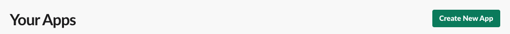

2. Pick **Paste a manifest**, then **Continue**.

   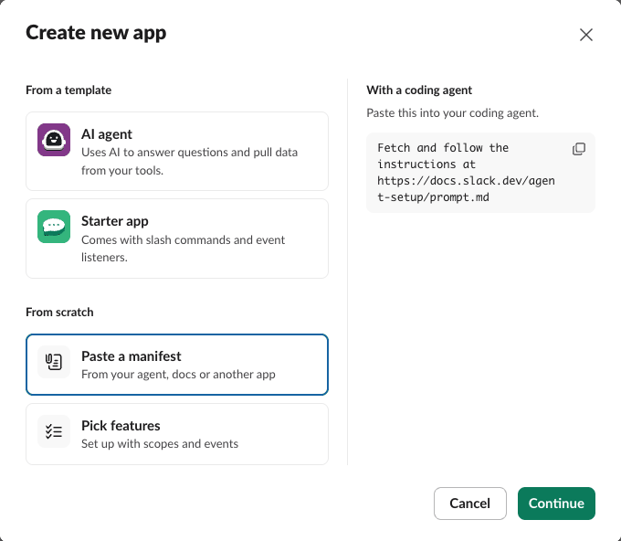

3. Replace the sample text with the whole content of `slackmod/slack-app-manifest.json`. Under **Workspace**, pick the workspace the bot will live in, then **Next**.
   - For more than one bot, change `"name": "mod-for-slack lead"` and `"display_name": "lead"` to the bot's name before pasting. `display_name` is the name you call in Slack, as in `@lead`.

   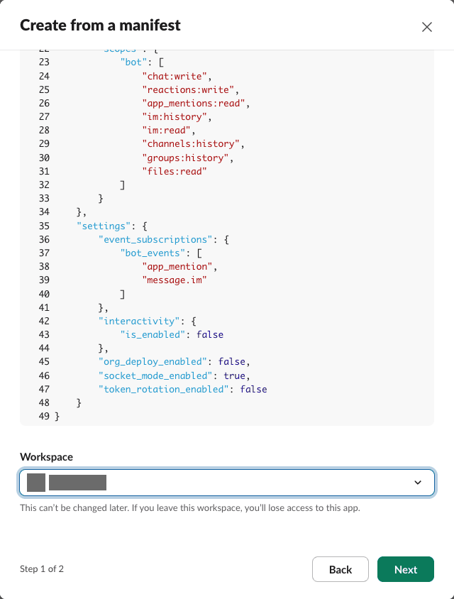

4. When the review shows 8 permissions and 2 events, click **Create**.

   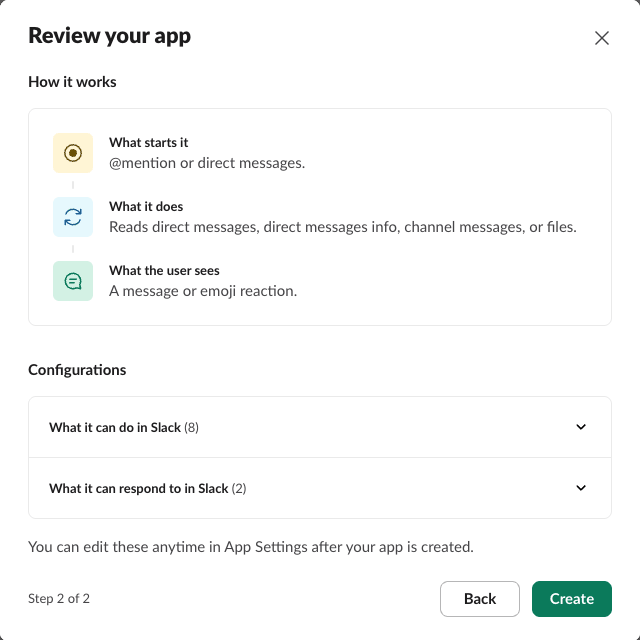

The app settings open. The steps below use the menu on the left.

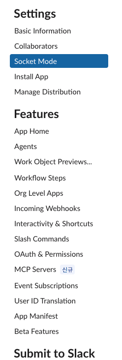

**Socket Mode** is already on (the manifest turns it on). mod-for-slack connects to Slack this way, so you do not need a public address or web server.

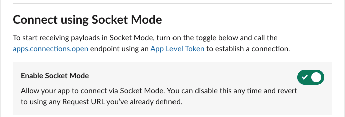

## 2. Create the app token (`xapp-`)

1. **Basic Information** → the **App-Level Tokens** box → **Generate Token and Scopes**.

   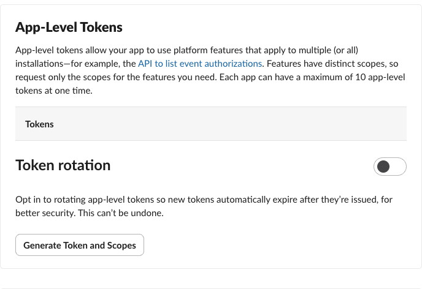

2. Give it any **Token Name** (for example `socket`), use **Add Scope** to add `connections:write`, then **Generate**.

   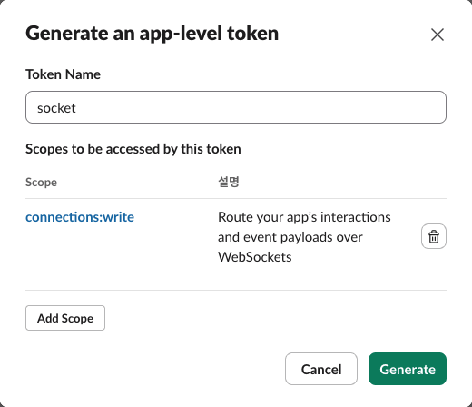

3. Slack shows a token starting with `xapp-`. Do not copy it into a note or a chat. Leave this page as it is in this browser tab, and open the app settings in a **new tab** for the next step (in «5. Put the tokens into mod-for-slack» you switch between the two tabs to paste).

## 3. Install to the workspace and get the bot token (`xoxb-`)

1. **OAuth & Permissions** → the **OAuth Tokens** box → **Install to (your workspace)**.

   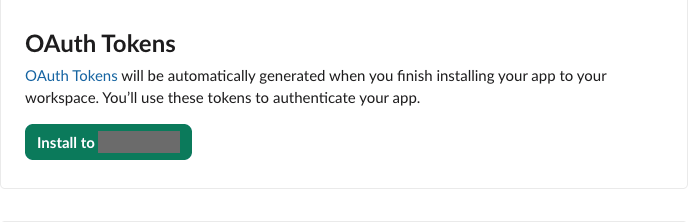

2. Check what the app can see and do, then click **Allow**.

   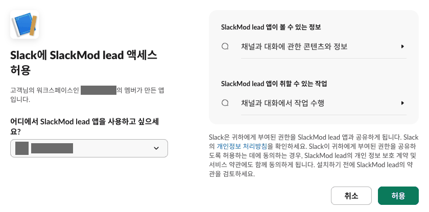

   - If your workspace requires admin approval for new apps, the app is not installed right away; it waits for an admin. Come back to this step once it is approved.

3. After the install, the same **OAuth Tokens** box shows the bot token (Bot User OAuth Token) starting with `xoxb-`. You copy this one in «5. Put the tokens into mod-for-slack» too.

Further down the same page, **Bot Token Scopes** lists the 8 permissions from the manifest. What mod-for-slack uses them for:

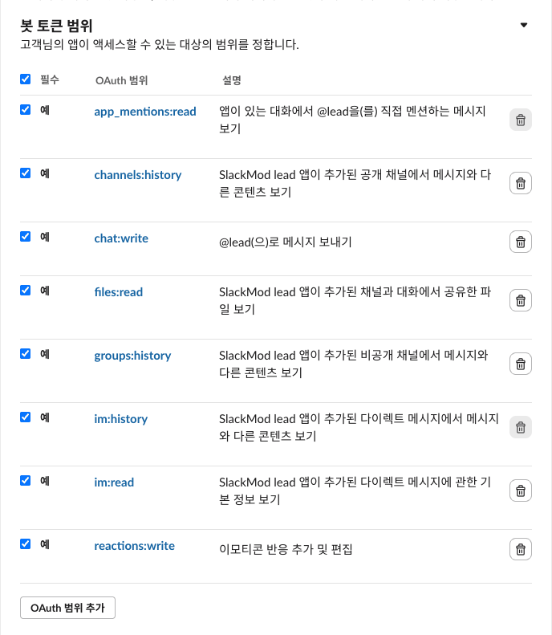

| Permission | Used for |
|---|---|
| `chat:write` | the bot posts its replies |
| `reactions:write` | the bot adds an emoji reaction to a message it received |
| `app_mentions:read` | receiving channel posts that `@mention` the bot |
| `im:history` · `im:read` | receiving direct messages to the bot and finding its DM conversations |
| `channels:history` | the post-install health check (the check table the setup wizard shows) reads one channel message to confirm the connection · needed if you turn on `message.channels` below |
| `groups:history` | in a private channel, the post-install health check reads one message there (drop it from the manifest if you use public channels only) |
| `files:read` | receiving files attached to a message |

## 4. Check the events (`message.channels` is optional)

**Event Subscriptions** → **Subscribe to bot events** lists the two events from the manifest.

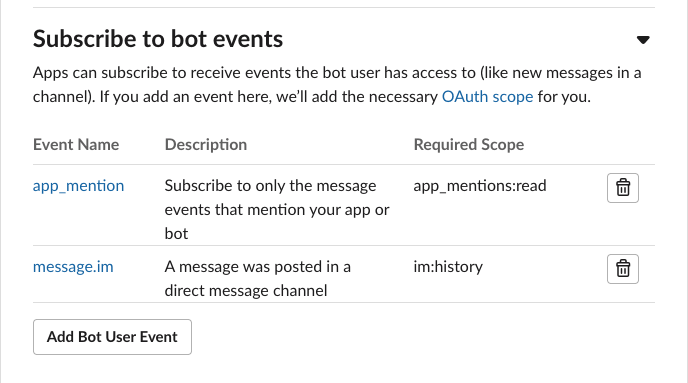

- `app_mention` = a channel post that `@mentions` the bot · `message.im` = a direct message to the bot. These two are the mod-for-slack default.
- `message.channels` is left out on purpose. Without it, Slack never sends the bot a channel post that does not mention it. Add it with **Add Bot User Event** only when:
  - you want the bot to receive follow-ups without `@bot` in a thread it is already answering, or
  - you want the notice that tells a bot its post was not delivered because it had no mention (`slack.drop_notice_no_mention`).
- If, after adding it, the page shows a notice at the top asking you to reinstall the app, reinstall as it says.
- Several bots in one channel is fine: a channel post reaches only the bot it names (follow-ups without a mention in a thread that bot is already answering are the exception).

## 5. Put the tokens into mod-for-slack

1. Invite the app to the channel the bot will use: in that channel, `/invite @lead` (or the `display_name` you chose).
2. Have the two values the setup wizard asks for: the channel ID (starts with C · bottom of the channel details) and the user ID of the person who talks to the bot (starts with U · profile ⋯ → Copy member ID).
3. In the terminal the wizard opens at the end (or any terminal):

   ```bash
   slackmod set-token lead
   ```

   It asks (in Korean) `1) Bot User OAuth Token (xoxb- 로 시작)` then `2) App-Level Token (xapp- 로 시작)`. Copy the first from the bot token tab (OAuth & Permissions) and the second from the app token tab (the tab you left open in section 2). The terminal waits until you paste. Nothing shows on screen while you paste — that is expected.

   Use the bot name you set in the setup wizard in place of `lead` (default: `lead`).
4. Check: in `slackmod status` the bot's token is no longer `missing`. Starting the bot is described in [«First use» in the README](../README.en.md#first-use).

## Letting a browser AI agent do it

The setup wizard's «do it all in the browser» is different from what follows. The wizard moves the browser only through its own fixed script; the script also clicks **Generate** and **Allow**, but it takes each token out of the page and saves it straight into the bot (nothing in the AI chat or its output, and no screenshots). The rest of this section is about handing the work to an agent yourself, outside the wizard.

A browser AI agent (for example Aside or ego lite) can move through sections 1–4 above for you (from creating the app to checking the events). Stop the agent at two buttons — **Generate** in the token window and **Allow** on the install consent page — and click them yourself (below). When you hand back to the agent, keep it off any tab that shows a token. The screenshots on this page were taken by driving the Aside browser automatically: creating the app from the manifest, picking the workspace, the settings pages, the token window and the install consent page all worked that way. ego lite was not tried.

What a person still does:

- **Sign in to Slack in that browser.** The agent works in a browser that is already signed in.
- **Click Generate in the token window.** The token appears on screen right after, so keep the agent off that page.
- **Click Allow on the install consent page.** It lets an app into your workspace, so a person should click it (while making this page we clicked Cancel, not Allow).
- **Admin approval**, if your workspace requires it.
- **Put the two tokens into mod-for-slack.** For now the only way is a person pasting them in a terminal, as in «5. Put the tokens into mod-for-slack».

Keeping the tokens out of conversations and logs:

- Ask the agent to stop the token window right before **Generate** and the install right at the consent page; a person clicks **Generate** and **Allow** and copies the tokens. If the agent reads a page that shows a token, the value can end up in the agent's conversation log.
- Do not ask the agent to «read» or «tell you» a token, and do not paste a token into the chat.
- If the agent takes screenshots, have it skip any page that shows a token.

## Deleting the app

**Basic Information** → **Delete App** at the bottom. As the confirmation says, deleting the app makes all of its tokens invalid and cannot be undone. Undoing the mod-for-slack side is in [«Undo» in the README](../README.en.md#undo).

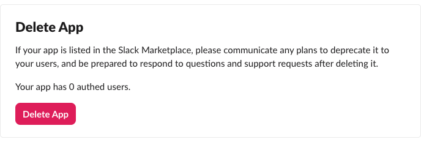

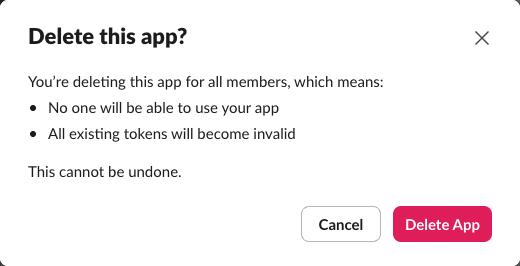
