# Slack 앱 만들고 열쇠 받기

[English](slack-app.en.md)

> **설치 마법사가 대신 할 수 있습니다.** 이 컴퓨터에 브라우저 도구 Aside 가 있으면 설치 마법사(`bash install.sh`)가 이 문서의 앱 만들기부터 열쇠(토큰) 저장까지 브라우저로 대신합니다 — 사람 몫은 워크스페이스 고르기와 Next(로그인이 안 돼 있으면 로그인)뿐이고, 열쇠는 AI 대화와 출력에 나오지 않고 바로 봇에 저장됩니다(브라우저 탭에는 Slack 이 평소처럼 열쇠를 잠깐 띄웁니다). 열쇠 단계만 사람이 하는 «앱 만들기만 대신»도 고를 수 있습니다. 이 문서는 직접 할 때의 순서입니다.

SlackMod 봇 하나는 Slack 앱 하나를 씁니다. 봇이 둘이면 앱도 둘 만듭니다(두 봇이 한 앱을 같이 쓰면 메시지가 갈립니다). 이 문서는 앱 하나를 만들어 SlackMod 에 넣을 열쇠(토큰) 두 개를 받는 순서입니다.

- 준비물: Slack 워크스페이스에 로그인된 브라우저 · 저장소의 [`slackmod/slack-app-manifest.json`](../slackmod/slack-app-manifest.json)(앱 설정을 한 번에 채우는 파일)
- 받는 열쇠: `xapp-` 로 시작하는 앱 토큰 1개 · `xoxb-` 로 시작하는 봇 토큰 1개
- Slack 화면 글은 계정 언어에 따라 영어와 한국어가 섞여 보일 수 있습니다(아래 그림도 섞여 있습니다). 본문에 적은 버튼 이름으로 찾으면 됩니다.

> **열쇠는 비밀번호와 같습니다.** 채팅창·이슈·스크린샷·AI 대화에 붙이지 말고, 마지막 단계에서 터미널에 바로 붙여 넣으세요.

## 1. 매니페스트로 앱 만들기

1. <https://api.slack.com/apps> 를 열고 **Create New App** 을 누릅니다.

   

2. **Paste a manifest** 를 고르고 **Continue**.

   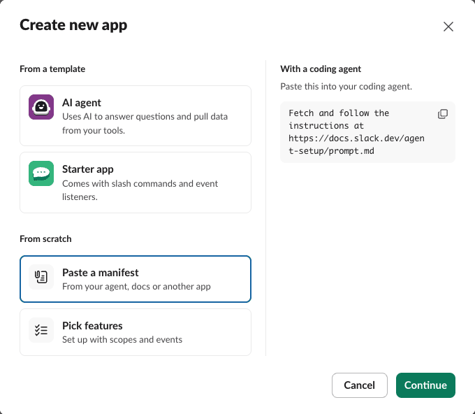

3. 입력 칸의 예시 글을 지우고 `slackmod/slack-app-manifest.json` 내용을 통째로 붙여 넣습니다. 아래 **Workspace** 에서 봇을 둘 워크스페이스를 고르고 **Next**.
   - 봇이 여럿이면 붙여 넣기 전에 `"name": "SlackMod lead"` 와 `"display_name": "lead"` 두 곳을 봇 이름으로 바꾸세요. Slack 에서 `@lead` 처럼 부를 이름이 `display_name` 입니다.

   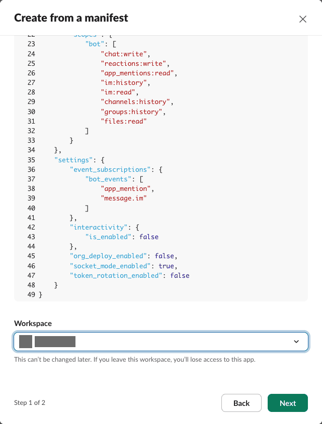

4. 검토 화면에 권한 8개 · 이벤트 2개가 보이면 **Create**.

   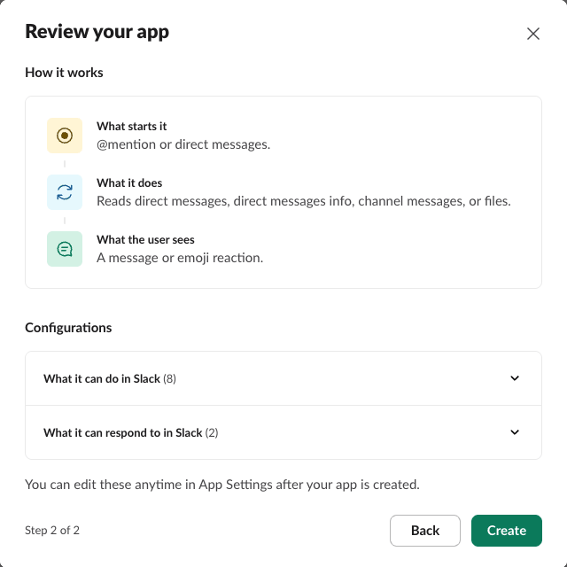

앱 설정 화면이 열립니다. 왼쪽 메뉴에서 아래 단계의 메뉴를 찾습니다.

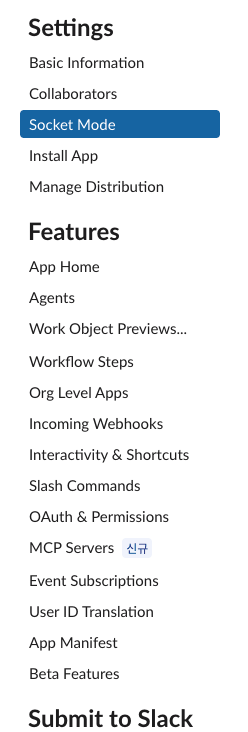

**Socket Mode** 는 매니페스트가 이미 켜 두었습니다. SlackMod 는 이 방식으로 Slack 과 연결하므로 공개 주소(웹 서버)가 필요 없습니다.

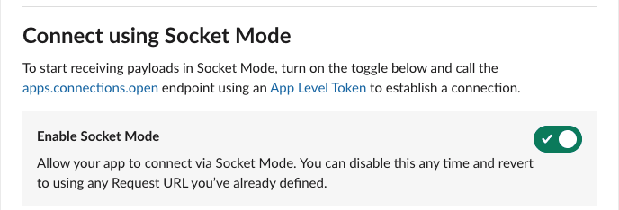

## 2. 앱 토큰(`xapp-`) 만들기

1. 왼쪽 **Basic Information** → 아래쪽 **App-Level Tokens** 칸의 **Generate Token and Scopes**.

   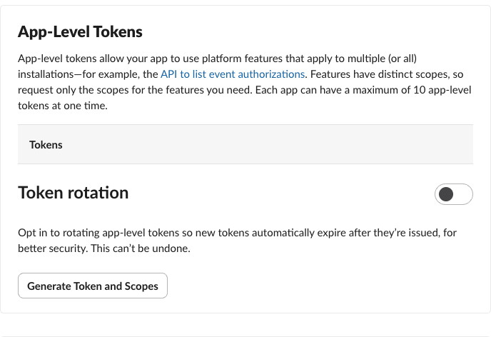

2. **Token Name** 에 아무 이름(예: `socket`)을 쓰고 **Add Scope** 로 `connections:write` 를 넣은 뒤 **Generate**.

   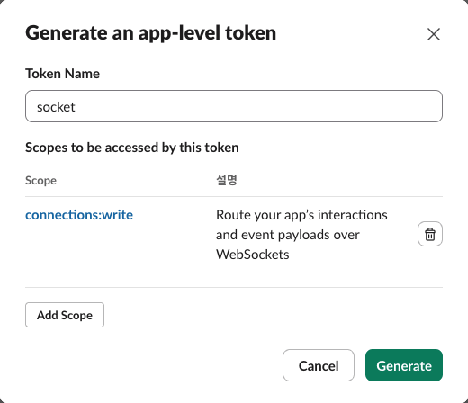

3. Slack 이 `xapp-` 로 시작하는 토큰을 보여 줍니다. 메모장이나 채팅에 옮겨 두지 마세요. 이 화면은 이 브라우저 탭에 그대로 두고, 다음 단계는 앱 설정을 **새 탭**으로 하나 더 열어 진행합니다(아래 «5. SlackMod 에 열쇠 넣기»에서 두 탭을 오가며 붙여 넣습니다).

## 3. 워크스페이스에 설치하고 봇 토큰(`xoxb-`) 받기

1. 왼쪽 **OAuth & Permissions** → **OAuth Tokens** 칸의 **Install to (워크스페이스 이름)**.

   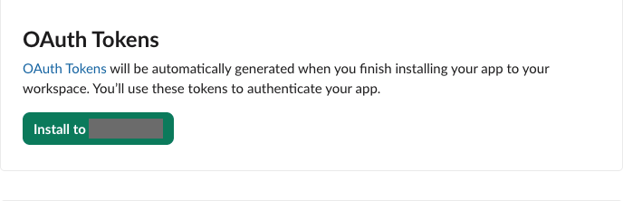

2. 허락 화면에서 앱이 볼 수 있는 정보·할 수 있는 작업을 확인하고 **허용**(Allow).

   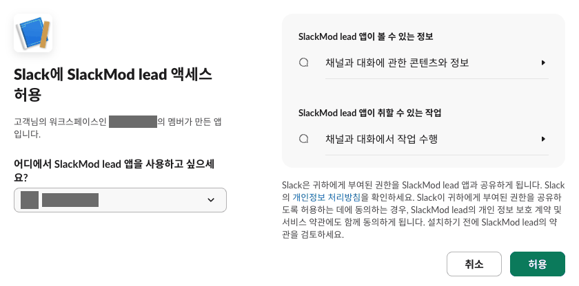

   - 워크스페이스가 앱 설치에 관리자 승인을 요구하도록 설정돼 있으면, 이 자리에서 바로 설치되지 않고 관리자의 승인을 기다립니다. 승인이 나면 다시 이 단계를 진행하세요.

3. 설치가 끝나면 같은 **OAuth Tokens** 칸에 `xoxb-` 로 시작하는 봇 토큰(Bot User OAuth Token)이 생깁니다. 이것도 «5. SlackMod 에 열쇠 넣기»에서 복사합니다.

같은 화면 아래 **봇 토큰 범위**(Bot Token Scopes)에 매니페스트가 넣은 권한 8개가 있습니다. SlackMod 가 쓰는 곳은 이렇습니다.

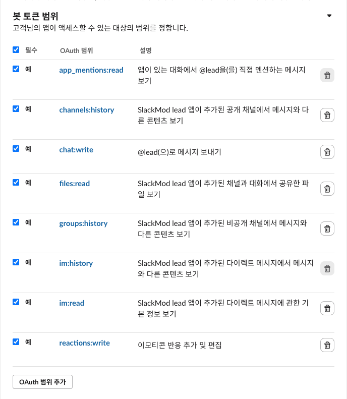

| 권한 | 쓰는 곳 |
|---|---|
| `chat:write` | 봇이 답글을 씁니다 |
| `reactions:write` | 받은 글에 이모지 반응을 답니다 |
| `app_mentions:read` | 채널에서 `@봇` 으로 부른 글을 받습니다 |
| `im:history` · `im:read` | 봇에게 온 DM 을 받고, DM 대화방을 찾습니다 |
| `channels:history` | 설치 뒤 점검(설치 마법사가 보여 주는 점검 표)이 채널 글 한 줄을 읽어 연결을 확인합니다 · 아래 `message.channels` 를 켤 때 필요합니다 |
| `groups:history` | 비공개 채널에서 쓸 때 설치 뒤 점검이 그 채널 글 한 줄을 읽습니다(공개 채널만 쓰면 매니페스트에서 빼도 됩니다) |
| `files:read` | 글에 붙은 파일을 받습니다 |

## 4. 받는 이벤트 확인 (`message.channels` 는 선택)

왼쪽 **Event Subscriptions** → **Subscribe to bot events** 에 매니페스트가 넣은 두 개가 있습니다.

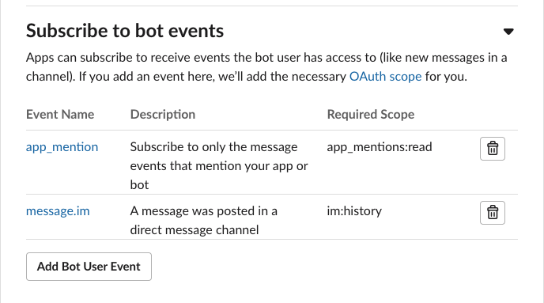

- `app_mention` = 채널에서 봇을 `@` 로 부른 글 · `message.im` = 봇에게 온 DM. SlackMod 기본은 이 둘입니다.
- `message.channels` 는 기본으로 넣지 않았습니다. 이것이 없으면 Slack 이 봇을 부르지 않은 채널 글을 봇에게 아예 보내지 않습니다. 그래서 이런 경우에만 **Add Bot User Event** 로 더하세요.
  - 봇이 이미 답하고 있는 스레드에서 `@봇` 없이 이어 쓴 글도 받게 하고 싶을 때
  - 봇끼리 일을 넘길 때, 멘션 없이 써서 전달되지 않았다고 알려 주는 알림(`slack.drop_notice_no_mention`)을 쓰고 싶을 때
- 더한 뒤 화면 위쪽에 앱을 다시 설치하라는 안내가 뜨면 그 안내대로 다시 설치하세요.
- 한 채널에 봇이 여럿이어도 괜찮습니다. 채널 글은 그 봇을 부른 글만 봇에게 넘어갑니다(봇이 이미 답하고 있는 스레드에서 멘션 없이 이어 쓴 글은 예외).

## 5. SlackMod 에 열쇠 넣기

1. 봇을 쓸 채널에 앱을 초대합니다: 그 채널에서 `/invite @lead`(이름을 바꿨으면 바꾼 `display_name`).
2. 설치 마법사가 묻는 두 값을 준비합니다: 채널 ID(C 로 시작 · 채널 상세 맨 아래) · 봇에게 말할 사람의 사용자 ID(U 로 시작 · 프로필 ⋯ → 멤버 ID 복사).
3. 마법사 끝에 열리는 터미널(또는 아무 터미널)에서:

   ```bash
   slackmod set-token lead
   ```

   `1) Bot User OAuth Token (xoxb- 로 시작)` → `2) App-Level Token (xapp- 로 시작)` 순서로 묻습니다. 첫째는 봇 토큰 탭(OAuth & Permissions)에서, 둘째는 앱 토큰 탭(2절에서 토큰을 띄워 두고 남겨 둔 탭)에서 복사해 붙여 넣으세요. 터미널은 붙여 넣을 때까지 기다립니다. 붙여 넣어도 화면에 글자가 보이지 않는 것이 정상입니다.

   `lead` 자리에는 설치 마법사에서 정한 봇 이름을 넣습니다(기본 봇 이름 = `lead`).
4. 확인: `slackmod status` 에서 그 봇 토큰이 `missing` 이 아니면 됩니다. 켜는 법은 [README](../README.md) 의 빠른 시작과 같습니다.

## 브라우저 AI 에이전트에게 맡길 때

설치 마법사의 «브라우저로 전부 대신»은 아래 방식과 다릅니다. 마법사는 정해 둔 대본으로만 브라우저를 움직이고, **Generate** 와 **허용**도 대본이 누르되 열쇠 값은 페이지에서 꺼내 곧바로 봇에 저장합니다(AI 대화·출력에 나오지 않고, 화면을 찍지 않음). 아래는 마법사 밖에서 에이전트에게 직접 맡길 때의 이야기입니다.

브라우저를 대신 조작하는 AI 에이전트(예: Aside · ego lite)에게 위 1~4절(앱 만들기부터 이벤트 확인까지)의 화면 이동과 입력을 맡길 수 있습니다. 다만 토큰 만들기 창의 **Generate** 와 설치 허락 화면의 **허용** 두 버튼은 에이전트를 멈추고 사람이 누릅니다(아래). 누른 뒤 이어서 맡길 때는 토큰이 보이는 탭을 에이전트가 열지 않게 하세요. 이 문서의 화면은 Aside 브라우저를 자동으로 조작해 찍었습니다 — 매니페스트로 앱 만들기 · 워크스페이스 고르기 · 설정 화면 확인 · 토큰 만들기 창 · 설치 허락 화면까지 자동 조작으로 진행할 수 있었습니다. ego lite 로는 확인하지 않았습니다.

사람이 해야 하는 일:

- **그 브라우저에서 Slack 에 로그인해 두기.** 에이전트는 로그인된 브라우저로 일합니다.
- **토큰 만들기 창의 Generate.** 누르면 토큰이 화면에 바로 나오니, 에이전트가 그 화면을 읽지 않게 사람이 누르세요.
- **설치 허락 화면의 «허용».** 워크스페이스에 앱을 들이는 결정이라 사람이 직접 누르세요(이 문서를 만들 때도 허용은 누르지 않고 취소했습니다).
- **관리자 승인.** 워크스페이스가 승인을 요구하면 관리자가 허락해야 합니다.
- **열쇠 두 개를 SlackMod 에 넣기.** 지금은 «5. SlackMod 에 열쇠 넣기»처럼 사람이 터미널에 붙여 넣는 방법뿐입니다.

열쇠가 대화·기록에 남지 않게 하려면:

- 에이전트에게 «토큰 만들기 창은 **Generate** 직전까지만 · 설치는 허락 화면까지만»이라고 맡기고, **Generate** 와 **허용**, 토큰 복사는 사람이 하세요. 에이전트가 토큰이 보이는 화면을 읽으면 그 값이 에이전트 대화 기록에 남을 수 있습니다.
- 에이전트에게 토큰을 «읽어 달라»·«알려 달라»고 하지 마세요. 토큰 값을 채팅에 붙여 넣지도 마세요.
- 에이전트가 화면을 캡처한다면 토큰이 보이는 화면은 찍지 않게 하세요.

## 앱을 지우려면

**Basic Information** 맨 아래 **Delete App**. 확인 창 안내대로, 앱을 지우면 그 앱의 토큰도 모두 쓸 수 없게 되고 되돌릴 수 없습니다. SlackMod 쪽을 되돌리는 법은 [README](../README.md) 의 «되돌리기»에 있습니다.

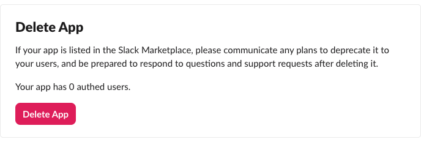

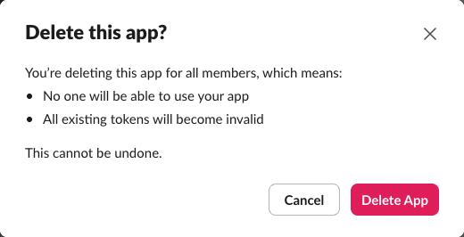
